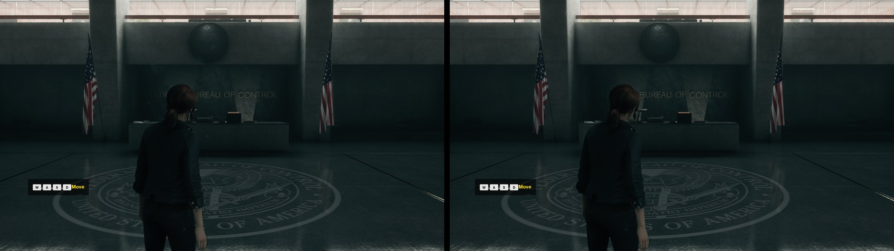

# Threshold

Threshold is a stereoscopic-3D, DLSS Frame Generation and DLSS-model mod for Remedy's
**Control** (Ultimate Edition, Direct3D 12) running under Proton. It is packaged for
[Quiver](https://github.com/AndrewGaspar/quiver) and exposes its settings through Quiver Options.
It is a sibling of [Torchbearer](https://github.com/AndrewGaspar/torchbearer) (Alan Wake
Remastered, the same engine family) and Pharos (Assassin's Creed Origins).



> **Status: work in progress (0.1.0).** Everything below was built and tested in Quiver's lab
> (headless instances of the game). Testing on a real stereo display (HypXRland / XReal) hasn't
> been done yet. Threshold hooks a specific game build by verified byte signatures: on a mismatch a
> feature logs it and turns itself off. Back up your saves.

## Features

- **DLSS Multi Frame Generation** (2x–6x; RTX 50 for 3x+): DLSS-G through the game's own NGX
  instance and D3D12 queue, with proxy back buffers and a paced present thread. It uses the
  engine's camera and a HUD-less image, so the UI isn't interpolated. It needs the game's DLSS on (any
  quality, DLAA included). See [`docs/fg.md`](docs/fg.md).
- **Same-frame stereoscopic 3D**: both eyes are rendered from one game update and composed side by
  side (full or half SBS, automatic on a HypXRland stereo output). Temporal state is kept per eye
  (DLSS, TAA, motion, RT denoisers), with separation, convergence and eye swap. See
  [`docs/stereo.md`](docs/stereo.md). Frame generation works in 3D too: one DLSS-G feature per eye,
  each with its own eye's depth, motion vectors and camera. With ray tracing, 3D is verified with all RT effects on,
  with and without frame generation; and it stays 3D through level changes (the right eye
  traces the left eye's acceleration structures).
- **Current DLSS models**: ships DLSS 310.9.16, so Quiver's *DLSS Super Resolution model* tweak can
  select the DLSS 4.5 presets M/L. It also turns off the game's default legacy (CNN) model.
- **Ray Reconstruction crash fix**: the game's RR path passes no inputs. Under Proton the driver's
  RR DLL is found and the game crashes on load with *DLSS quality 2*; Threshold refuses the RR
  feature, so the game uses Super Resolution as it does on Windows. See [`docs/dlss.md`](docs/dlss.md).
- **Skips the intro videos.**
- **Lab tooling** for automated testing: `where`/`teleport`/`jump`/`episode` verbs and 26 checked
  locations. See [`docs/navigation.md`](docs/navigation.md).

The Steam and GOG builds share byte-identical engine DLLs (the executables differ only in store
URLs), so the same mod applies to both.

## Build

Prerequisites: CMake 3.24+, Ninja, MinGW-w64 x86-64 GCC, curl.

```sh
scripts/fetch-deps   # NVIDIA DLSS SDK 310.9.16 and NVAPI headers into third_party/ (not redistributed here)
scripts/build        # -> build/mod/{dxgi.dll, nvngx_dlss.dll, nvngx_dlssg.dll, threshold.ini, Quiver manifests}
```

`build/package/` is the installable Quiver package
(`quiver mods gog:2049187585 install build/package`). The mod is a `dxgi.dll` proxy loaded from
the game folder (`dxgi=n,b`).

## Branches

- `main`: the tested state. Behaviour that hasn't been verified defaults to the verified one.
- `wip/*`: work in progress, each described in its branch's commits and the matching doc's resume notes.

## Reverse engineering

Notes are in [`re/`](re/), with every claim marked static, export or live. `scripts/dump-exports`
regenerates the engine DLLs' demangled export lists from your own install (they aren't
redistributed). `re/scripts/` has the headless Ghidra query server used for the analysis.

## License

MIT (see [LICENSE](LICENSE)). Third-party: MinHook (BSD-2-Clause, `third_party/minhook`). The NVIDIA
DLSS SDK and its DLLs are fetched at build time under NVIDIA's license and aren't part of this
repository.
