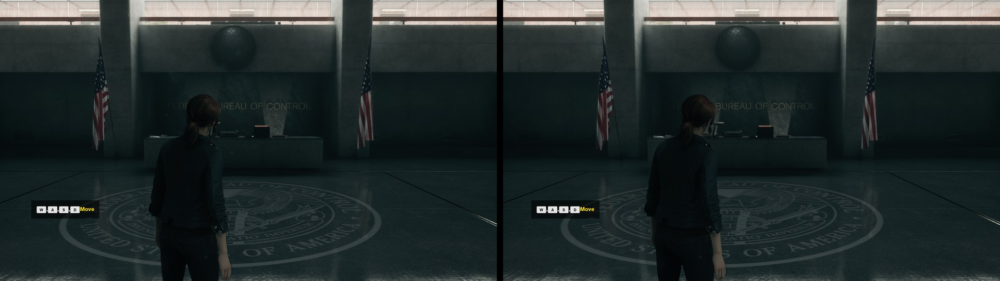

# Stereoscopic 3D: both eyes from one game update

> **This branch (wip/stereo-hdr-level-change)** defaults `rt_async_build` to 0: the HDR level-change hang
> fix is on, untested. On `main`, `[stereo] rt_async_build` defaults to 1 (the engine's own setting: no
> level-change hang in SDR on rayblaster). The HDR level-change hang fix (hold the async build off while pairs
> render) is on branch `wip/stereo-hdr-level-change`, untested (resume notes under "Level-change hang").

Threshold renders Control's world twice per game update, once per eye, inside one engine frame,
and composes them side by side. The design follows Torchbearer's (Alan Wake Remastered,
`~/code/torchbearer/docs/stereo.md`, "TB" below). The options and output modes mirror TB's.
Code: `src/features/stereo/` (`stereo.cpp` modes, hooks, composition, output; `eyestate.cpp` per-eye
state; `gpu.cpp` captures, the HUD draw duplication and the mono duplicate at Present; `window.cpp` the
full side-by-side window; `engine.h` every RVA and signature). Static background: [`re/stereo.md`](../re/stereo.md) and
[`re/dlss.md`](../re/dlss.md).

How each claim was established: "static" = read in Ghidra; "live" = observed in the lab (log, lab
verb or capture); "measured" = numbers from captures (`re/scripts/stereo_sbs.py`, patch matcher
`re/scripts/stereo_disparity.py` taken from TB). Lab instance `control-stereo`, 1920x1080 per
eye, GE-Proton11-12, RTX 5070 Laptop, the game's DLSS on (DLAA 1920x1080, preset K), RT on. Scene:
the start of the game (Continue on a fresh save, opening video and cutscene skipped): Jesse standing
in the Oldest House lobby, the reception desk ~4.3 m away, the wall emblem ~15 m.



*3840x1080 composite (downscaled), `mode = sbs`, 32.5 mm per eye, screen plane at 4 m: left eye
left, right eye right, the HUD hint in both halves.*

## What works

| | status | how established |
|---|---|---|
| Camera bias: `mode = left / right` | done | measured, below |
| Both eyes in one engine frame (`mode = sbs`), one Present per update | done | live, measured |
| Output `full` / `sbs` (2W swapchain, eyes 1:1) and `hsbs` (W swapchain, eyes squeezed 2:1) | done | live captures |
| HUD in both halves from one UI paint | done | live captures |
| Per-eye: previous camera, object motion, DLSS feature (and its reset), RT denoiser histories, SSR/AO/sun-shadow ping-pongs, volumetric light, TAA ring | done | measured (DLSS on r10; TAA ring with DLSS off r23) |
| Render-graph persisted resources (`lastcolorbuffer`, `previouslineardepth`) | shared on purpose (per eye available, `history_mask = 31`) | measured r20/r21: per eye is worse, see "Render-graph history" |
| TAA without DLSS (`m_eDLSSQuality: 0`) | done | measured r23 |
| `output = full` on a plain 2W-wide desktop: window widened, mouse per eye | done (borderless, windowed) | live, 3840x1080 lab display |
| HDR (FP16 scRGB swapchain): both eyes composed | done | live r24 (1046 pairs) |
| HDR: HUD in both eyes | **left eye only** (fix attempt hung the GPU) | live r24, r25 |
| Separation, convergence (image shift in sbs, projection in left/right), swap eyes | done, live | measured |
| `mode = auto`, `output = auto`, Hyprland window tag, Quiver stereo layout | done | live in the lab only without Hyprland (auto → off/none); HypXRland not tested |
| Frame generation at the same time | stereo stays off (logged); design below | live |
| Level change (jump point / teleport) while in sbs | SDR: no hang on rayblaster (7 loads); HDR: hangs (async-compute AS build vs raytrace queue); fix under test | live, "Level-change hang" |

Cost: two world renders per displayed frame. Measured (`quiver lab gpu`, 10 s windows, r12):
mono 81.4 / 61.2 presents/s, sbs 40.9 / 30.9 (two rounds; the ratio is 0.50 both times).

## How it works

### Frame structure (live)

- `RendererX86` slot 15 (`renderer+0x11daf0`, the world render), slot 17 (`renderHUD`), slot 18
  (`end`) and the Present all run on the "RMD - Renderer Thread" (census, one thread id). In the
  world there is one slot-15 call per frame; during Bink videos none (re/stereo.md Q1).
- In the world (and in menus, where `renderHUD` creates it) the scene and HUD go into the colour
  target `RendererX86+0x3c8`; the back buffer is untouched until `end` blits that target to it at
  (viewport offset, output size) with `copy.rfx/copyWithGamma` (live: back buffer in PRESENT state
  at `renderHUD` entry; static: `end` 0x134bb0). The target is the graph's final `colorbufferIN`,
  set by the Cleanup pass (static 0x134040; Q2).
- The camera: slot 15 gets the game's `m::View` by value. In gameplay `m00 = 1.5697`,
  `m11 = 2.7906` (16:9), view +x = camera right (live census; the opening cutscene uses 1.2598).

### One eye (`mode = left / right`)

The `m::View` argument is copied, its position moved along its own right row by ∓separation, and
re-derived with the exported `m::View::setViewToWorld` (rl); for convergence `viewToClip[2][0] +=
off·m00/Zc` through `m::View::setViewToClip`. The copy is passed to the original slot 15; shadow,
probe and reflection views are separate objects and are not moved.

### Both eyes (`mode = sbs`)

Per update, on the renderer thread:

1. Slot 15 runs twice with the left, then the right eye's view. After the left eye its final colour
   (+0x3c8) is copied to an eye texture.
2. Before the right eye, what `begin` prepares once per frame and a world render consumes is
   prepared again: `rend::SSAO`'s per-frame buffers (its vtable slot 1, `renderer+0x2434a0`; the
   RT pass's filter frees two of them after every render; without it the second render crashed on
   a null `+0x128`, live r4).
3. Visibility (culling) results: the game thread launches one culling query per `renderWorld`; the
   render pops one finished result per queue and returns the buffer to a pool of 2 (static
   `renderer+0x1b0300`, queues `+0x129bd70/+0x129bd10`). A second render waited forever for a
   second result (live hang, r6). The left eye's pops are kept and its returns held back; the right
   eye pops the same buffers and returns them (hooks on the queue pop/push, `renderer+0x1b3f20` /
   `+0x1b3fe0`). So both eyes use the centre camera's culling, as in TB.
4. `renderHUD`: both eyes are copied into a 2W x H texture from the engine's own render-target pool
   (`RenderTargetManager::allocTexture2D`, the colour target's format), each shifted for
   convergence; the HUD pass is then pointed at that texture and run **once**: the Coherent UI
   paints only once per frame (live: a second `renderHUD` drew no UI), so while it runs every draw
   recorded on the engine's command list is issued a second time with viewport and scissor moved
   right by W (hooks on the shared D3D12 command-list vtable, armed only for that call; TB's
   approach). Live r11: ~1300 duplicated draws per 700 frames, the hint box identical in both halves.
   In HDR the UI is painted into a separate RGBA8 target allocated per call at the output size
   (`RendererX86::pSeparateHudColorTarget`) and composed over the colour target by a compute pass
   (`copy.rfx/composeSceneAndUI`) dispatched over the *colour target's* size (static, renderHUD
   0x1343b0). The compose already covers our 2W texture; only the UI target was one eye wide, so the
   duplicated draws fell outside it (live r24: HUD in the left eye only). Making that one allocation
   2W wide during our call (dev `hdr_hud_wide = 1`, a hook on `RenderTargetManager::allocTexture2D`
   by name) hung the GPU within ~60 pairs (r25), so it is off and the HDR HUD is in the left eye only.
5. `end`: the side-by-side texture is put in +0x3c8 and the output size set to 2W for the call, so
   the engine's own blit (gamma included) draws both eyes into the 2W back buffer (`full`, `sbs`).
   With `hsbs` the output size stays W and the same blit samples the 2W texture into W: its
   bilinear fetch at exactly 2:1 averages each pixel pair (a box-filtered squeeze).
6. Frames without a pair (stereo off, menus, videos) with a packed output: `end` blits the one
   image into both halves (2D in the glasses).

All copies are recorded on the engine's own current command list through its exported
`d3d::NativeTextureUtil::copyRegion` (which does the engine-tracked state transitions). An earlier
build recorded them on our own lists after the engine's `submitGraphicsCommandList` "kick": the
halves came out swapped (measured: left half matched the right-eye mono capture to 0.01 px), i.e.
our copies were not ordered with the engine's final passes (Q3: the engine submits from more than
one list).

The CRT `rand()` is replayed for the right eye (TB's mechanism): the tonemap noise offset
(`g_vTonemapNoiseOffset`, static `renderer+0x22cf50`) is drawn per render. Measured r12,
separation 0: |L−R| mean 1.38-1.41/255 without, **0.15-0.27/255** with (pixels > 2: 21 % → 1-3 %).
What remains is on edges (the two DLSS features' antialiasing) and a lamp glint.

Two more things run once per render that must run once per update (static, this round):
- **DLSS reset**: the flag `renderer+0x128d1e6` is raised by `begin` (feature re-created, settings
  changed) and by slot 15 on a camera cut, and cleared right after `doAntiAliasing` (renderer
  0x13f581 / 0x1300e6). A reset raised in `begin` reached only the left eye's feature; it is now
  replayed for the right eye's feature (`reset_replay` in `stereo status`; static, no reset from
  `begin` was provoked live). A cut's reset is raised
  again by the right eye's own slot 15 call.
- **World video textures**: each render's "VideoDecoderStart" pass (renderer+0x123880) calls the
  exported `VideoStreamerFactory::updateAsync`, which starts a Bink decode job that "Scene update"
  waits for. The right eye's call is skipped (its wait finds the left eye's finished job;
  `video_skip`). This did *not* fix the level-change hang (open issues).

### Per-eye temporal state (`eyestate.cpp`)

The left eye uses the engine's own state, the right eye a second set swapped in around its render.

| state | what | how |
|---|---|---|
| previous camera (camera motion vectors, `g_m*Previous*`) | main `rend::View` +0x3d0/+0x450/+0x4b0 | each eye's current matrices kept after its render and put back before its next one (static: `storePrevious` 0x180700 from `end`) |
| object previous transforms (object motion vectors) | Cleanup pass copies Object +0x70 → +0xa0 only when the high-res-screenshot tile index == count (`renderer+0x802978/7c`) | the left eye renders as a non-final tile (count = index + 1): both eyes see last update's transforms; the right eye advances them. The ambient probe, guarded the same way, updates once (right eye) |
| DLSS history | `DLSSData+0x28/+0x30` (d3d `0x111be0`) | a second NGX feature created from the engine's own create parameters (sizes, quality, flags, preset hints) through the game's exported NGX entry points, swapped in for the right eye; re-created when the engine's feature changes, released 3 presents after its last use |
| RT denoiser (DLF) histories | 4 globals `renderer+0x90eac8, 0x912b18, 0x910b98, 0x90eb98` | pointer swap (the filters allocate on null; static) |
| SSR / AO / sun-shadow temporal | `rend::SSAO` (r+0xd8) ping-pong pairs +0x100..+0x138 | pointer swap; its prepare allocates the right eye's |
| volumetric light | r+0xe8: +0x18 history, +0x40..+0x70 remembered camera | swap (history null falls back to the current buffer) |
| TAA ring (DLSS off) | SSAA r+0x138, 3 slots of {view, texture} | block swap; the right ring starts as a copy with no textures (the resolve allocates them) |
| render-graph persisted resources | vector `renderer+0x910c20` | **shared by default** (`history_mask` bit 1 swaps the whole list per eye; measured worse, "Render-graph history") |

Measured (r10, 32.5 mm, parallel; reference = the mono-frame `left`/`right` pair of the same run,
per-patch disparity of each capture's halves vs the reference's):

| variant | median of all patches | far field (y < 500) | per patch vs reference: median / mean \|diff\| |
|---|---|---|---|
| reference (mono-frame left / right) | +9.13 px | +6.98 px | |
| **per eye** (default), 3 captures | +8.97 .. +9.07 px | +6.96 .. +6.98 px | **−0.006 .. −0.008 / 2.5-4.0 px** |
| everything shared (`per_eye = 0`) | +7.83, +7.87 px | **+4.32 px** (−38 %) | −0.43 / 5.0-5.2 px; 30 % fewer confident patches |
| per eye but one DLSS feature (`dlss_per_eye = 0`) | **+0.008 px** | +0.01 px | −9.3 / 15.8 px |

With one DLSS history and per-eye motion vectors the right eye's vectors say "no motion", so DLSS
keeps the left eye's accumulated image: the halves become identical. With everything shared the
eye switch reads as camera motion and the far field loses 38 % of its disparity. Per eye the field
matches the mono-frame one patch by patch (the mean |diff| is the player's idle motion between
captures; static regions match to ±0.1 px).

## Measurements

Disparity `K = 2·e·m00·W/2` = 97.95 px·m at 32.5 mm, m00 1.5697, W 1920.

- **Mono-frame bias** (r3, `left` vs `right`, separate frames): parallel field depth-consistent:
  player 50.7 px (1.9 m), desk 22.0 px (4.45 m), emblem 6.4 px (15.3 m). Two consecutive mono
  frames: median 0.02 px. Convergence 4 m in the projection: each eye shifted uniformly by
  −12.21 / +12.20 px (expected 0.0325·1.5697/4·960 = 12.24); parallel − converged 24.4 px on static
  regions → Zc = 4.0 m.
- **Same update** (r10-r12, `sbs`, 3840x1080 captures of the presented buffer): per-patch match
  with the mono-frame pair, above. Separation scaling (r12, one frame each): per-patch ratios
  32.5/16.25 = **2.000**, 65/16.25 = **3.996**, 65/32.5 = **2.000**. `swap_eyes` at 65 mm:
  −15.21 px against +15.17.
- **Convergence in sbs** (image shift, r10): parallel − converged per patch **24.01 px** (24 px
  applied: the 24.49 px total rounded and split 12/12) → Zc = 4.08 m for 4 set.
- **hsbs** (r13): 1920x1080 swapchain, both eyes squeezed, HUD in both; disparity in squeezed
  pixels 4.07 px median (full width 9.07).
- **FG enabled** (r14): `stereo: [fg] enabled = 1: stereo stays off`, swapchain not widened.
- **Inert** (r17, shipped defaults, no Hyprland): `output auto -> none`, mode resolves to off; the
  hooks pass through and no GPU resources or command-list hooks are created.
- Live switching sbs ↔ off ×4 (r15): right-eye DLSS features created 3, released 2 (+1 in use),
  game alive.

### Render-graph history (`lastcolorbuffer`, `previouslineardepth`)

**What the list holds** (static, renderer 0x11ee20 graph builder / 0xa09a0 executor; live `stereo
graph`). Resources declared persistent are appended at the end of each graph run to the vector at
`renderer+0x910c20` ({ptr, u32 count, u32 capacity | 0x40000000 "not owned"}, entries 0xa0: +0 name
hash (FNV-1a 64), +0x10 `Texture2DInit`, +0x88 type, +0x8c flags, +0x90 resource). At the start of
the next run, type-2 alias entries claim a previous entry by name, everything unclaimed is freed,
and the count is reset. In the lobby the list has exactly three entries (live, hashes matched
against the renderer's strings):

| entry | format | read next frame as |
|---|---|---|
| `lineardepthcopy` (hash `ca970354…`) | R16_FLOAT, render size | `previouslineardepth` (`g_tPreviousLinearDepth`: RT pass, TAA) |
| `colorBufferCopy-2` (`25e4aa95…`) | R16G16B16A16_FLOAT, render size, mips | `lastcolorbuffer` (`g_tPreviousColor`: SSR, which builds its mips, RT reflections, "Final-image binding place") |
| `color_dlss_aa` (`286037ba…`; `color_taaout` with TAA) | R10G10B10A2, output size | nothing: persisted only so the final colour outlives the graph (Cleanup puts it in +0x3c8 for renderHUD/`end`); freed unclaimed by the next run |

**The black right eye of r9 is not reproduced.** A list that starts empty gives the two aliases a
null resource for one frame (the executor never allocates a type-2 entry), which is also the
engine's own first frame. There is no auto-exposure history in the list: the "autoexposure" pass
keeps its state outside the graph (static), so the earlier "exposure history starting at zero"
guess is refuted. Live: per-eye lists from launch (r19, cinematic and gameplay, 7351 pairs), switched
on live in the world (r18), and r9's exact bisect sequence replayed (`history_mask` 31, 1, 2, 4, 8,
16, 0, 1, 31; r19) all render both eyes. r9's build is gone; whatever made it black is not in the
current code.

**Per eye is measurably worse, so the list stays shared.** Method: photo mode (pause menu → Photo
Mode, `t` hides its UI) freezes the world while it keeps rendering, so captures and the mono-frame
references show the same instant (no idle animation between them). Lobby, 32.5 mm, parallel, DLSS
DLAA, 2 captures per variant (r20). `graph_cross` (dev) keeps per-eye lists but copies one entry's
content from the other eye's latest, to bisect which entry matters:

| variant | ghost zones L / R (mean \|diff\| to the mono reference, /255) | whole frame L / R | disparity vs reference: median / mean \|diff\| |
|---|---|---|---|
| shared list (`history_mask = 30`, default) | **1.13 / 1.23** | 1.576 / 1.603 | **−0.036 / 2.44 px** |
| per-eye lists (`31`) | 1.57 / 2.02 | 1.619 / 1.616 | −0.060 / 2.72 px |
| per-eye, depth content crossed (`31`, `graph_cross = 1`) | 1.15 / 1.23 | 1.577 / 1.600 | −0.038 / 2.49 px |
| per-eye, colour content crossed (`graph_cross = 2`) | 1.54 / 1.97 | 1.594 / 1.602 | |
| per-eye, both crossed (`graph_cross = 3`) | 1.12 / 1.23 | 1.576 / 1.600 | −0.037 / 2.44 px |
| everything shared (`per_eye = 0`) | 2.00 / 1.77 | 3.468 / 3.858 | |

With per-eye lists each eye shows a faint silhouette of the *other* eye's Jesse on the floor beside
her (left eye on her left, right eye on her right; the "ghost zones" are where it is, found from the
difference of the two variants). It comes from `previouslineardepth`: crossing only the depth removes
it, crossing only the colour does not. So some consumer of the previous linear depth pairs it with
state that is still "the last render's" (i.e. the other eye's). Shared, that state and the shared
depth agree. Bisecting the other per-eye sets with the depth per eye (`history_mask` 23, 27, 29, 15:
volumetric, SSAO pairs, DLF, TAA ring shared in turn) did not remove the ghost, so the partner is
outside every set swapped today (candidates read statically: the view-volume (froxel) lighting
history `renderer+0x191de0` object +0x20/+0x28, which is reprojected with the per-eye camera but not
swapped; the RT pass's other temporal inputs). Per-eye `lastcolorbuffer` alone (`graph_cross = 1`)
gave no measurable change against shared anywhere in the lobby: whole frame, ghost zones, disparity,
and the reflective floor at the screen edges (240 px strips, y > 640, L / R: right edge 3.032 / 3.027
with per-eye colour, 3.024 / 3.023 shared, 3.056 / 3.023 all per eye; left edge 1.435 / 1.432,
1.426 / 1.414, 1.453 / 1.430), so it is not worth two extra copies per frame. The corridor with stronger
reflections was not measured (the teleport there hung, open issues).

Earlier lobby captures with the player idling (r18, not frozen): per-eye vs shared, reflective floor
regions away from the player within ±0.1/255 of each other, disparity vs reference 3.67-3.80 vs
3.89-3.93 px mean |diff| (player animation dominates).

### The full side-by-side window (`output = full`, `window.cpp`)

The game's window is `app::WindowX86` (app_rmdwin10_f.dll; imported and analysed for this, static):
+0x20 HWND, +0x3c/+0x40 the client size the engine renders at, +0x147 set while its own
create (slot 1, app+0x5100) / resize (slot 8, +0x5660) / borderless (slot 11, +0x6000) call
SetWindowPos (its WM_WINDOWPOSCHANGING then forces that size), +0x230 borderless. Monitor rectangles
come from its own list (`app+0x20de8`, MONITORINFOEXA), refreshed by `app+0x4c90` before each use and
read by the exported `app::getMonitorInfo`. Absolute mouse positions are normalised by the real
client rectangle (WM_MOUSEMOVE `app+0x6c20`, the cursor getter `app+0x6b30`).

With `output = full`:
- a monitor at least 3x as wide as tall (a doubled 16:9 desktop) is reported half as wide (hook on
  `app+0x4c90`), so borderless sizes the engine to one eye;
- the window is subclassed (`SetWindowLongPtr`, no function hook) and widened to a 2W client on its
  own thread (a posted message; never from the renderer thread); WM_SIZE reaches the engine as W;
  when the engine's own resize sets it back to W it is widened again;
- absolute mouse x reaches the engine as the position within the eye under the cursor
  (`x mod W`), WM_MOUSEMOVE and the cursor getter alike; relative (mouse-look) input is untouched;
- a 2W client that would not fit the monitor is not attempted (a 1920 desktop keeps the squeezed
  view; live r23/r24: a 3840 window on the 1920 gamescope output showed black).

Verified live on a 3840x1080 lab display (instance `control-stereo-wide`, runs r1-r5):
- Borderless (`m_eWindowMode 1`, r1): `engine 1920x1080 (borderless), client 1920x1080 -> 3840x1080
  at 0,0`, monitors halved 2; the gamescope output shows both eyes 1:1 over 3840 (no squeeze).
- Windowed (`m_eWindowMode 0`, r4): `engine 1920x1080 (windowed), client 1920x1080 -> 3840x1080`;
  title screen in both halves 1:1.
- Mouse (r1, pause menu): the cursor at (2052, 582), over "Photo Mode" in the right half, highlights
  "Photo Mode" in both eyes; at (132, 497), left half, "Options".
- Mouse-look unchanged: 200 px of relative motion turned the camera 33.3° and 100 px pitched it
  17.0° (0.166 vs 0.170 °/px: horizontal not halved by the 2x client).
- **Exclusive fullscreen** (`m_eWindowMode 2`, r2, r5) stalls at the title screen (renderer idle,
  game thread stuck) with or without the window subclass, so it is the 2x swapchain in exclusive
  mode, not this code; the subclass is skipped when the swapchain is fullscreen. Use borderless.

### TAA without DLSS (`m_eDLSSQuality: 0`)

r23, frozen photo mode, lobby, 32.5 mm parallel (`dlss.on: false` in `stereo status`; the right eye's
TAA ring swapped, `history_mask` bit 16):

| variant | disparity, median of all patches | vs mono reference: median / mean \|diff\| | separation 0: \|L−R\| mean, % > 2 |
|---|---|---|---|
| per eye (default) | +19.96, +19.97 px | **−0.07 / 1.90 px** | **0.082**, 0.69 % |
| TAA ring shared (`history_mask = 14`) | −0.001, +0.005 px | −20.0 / 17.4 px | 0.153, 0.94 % |
| everything shared (`per_eye = 0`) | +0.015, +0.016 px | −20.0 / 16.4-16.6 px | 0.166, 0.87 % |

Like one DLSS history, one TAA ring makes the halves identical (the resolve reprojects the shared
history with each eye's own stored ring views and converges to one image): the per-eye ring is
required and works. Against the mono references the per-eye halves differ by 1.40 / 1.02 (whole
frame, /255) vs 2.23 / 1.46 with the ring shared.

### HDR

Lab instance `control-stereo` with `display.hdr=on` (gamescope HDR10 PQ), renderer.ini
`m_eAllowHDR 1`, DLSS DLAA. The game's swapchain is R16G16B16A16_FLOAT (`swapchain … fmt 10`),
scRGB; the side-by-side texture follows the colour target's format (engine format 23, FP16).

- Composition (r24, 1046 pairs, no stall): the 2W back buffer captured raw (`stereo shots 1
  TAG_raw`, 3840x1080 FP16): both eyes present with the expected disparity, no NaN/Inf, channel
  max 3.12 (≈250 nits at 80 nits per 1.0), mean 0.14; `quiver lab shot --hdr` (the 1920 gamescope
  output) max 251 nits, p99 146, 0.2 % above 203 nits paper white.
- Menus and the title screen (no pair): `end`'s mono duplicate puts the menu in both halves.
- **HUD: left eye only.** In HDR the engine paints the UI into a separate one-eye-wide RGBA8 target
  and composes it with a compute pass over the colour target; our duplicated draws land outside that
  target. The compose is dispatched over the colour target's own size (2W), so a 2W UI target is all
  that is missing; allocating it 2W (dev `hdr_hud_wide`) made the GPU stop ~60 pairs later (r25:
  the renderer thread blocked in vkd3d inside our next `copyRegion` in `end`; no `signaller_worker`
  timeouts that time). Not investigated further: the UI target is bound together with the
  one-eye-wide depth buffer `renderHUD` allocates (`RenderToTexture(target, depth)`), and draws past
  the depth buffer's extent are a plausible GPU fault; the SDR path binds our 2W texture with that
  depth buffer too and is fine, so this is a guess. Next: also allocate that depth buffer 2W, or
  compose the UI ourselves into the right half from the UI target before it is freed.
- Per-eye output: captures are linear FP16; `stereo_sbs.py raw` decodes them (also R11G11B10 and
  R10G10B10A2), and BMP captures of FP16 are now clamped and gamma-encoded instead of garbled.

## Stereo with frame generation (design, not implemented)

Today `[fg] enabled = 1` keeps stereo off (stereo_start). The FG feature (src/features/fg/, another
agent's, changing as of this writing: `engine.cpp`/`trace.cpp` were added and `fg.cpp` edited within
the last hour) taps the game's one DLSS-SR evaluation per frame (`NVSDK_NGX_D3D12_EvaluateFeature_C`
hook: depth, MVs, jitter), reads the main view's camera inside it, takes the HUD-less colour at
`renderHUD` entry (vtable slot 17 patch) and presents the real frame plus N generated ones from proxy
back buffers. In sbs there are two SR evaluations per update (the engine's feature, then the
right-eye feature `eyestate.cpp` swaps in), one `renderHUD` on the 2W texture, and one 2W Present.

Two shapes:
1. **DLSS-G on the composed SBS frame** (one feature, 2W): cheapest, but DLSS-G takes one camera
   (view/clip matrices, position, basis) per frame and its optical flow and MV warp would run across
   the seam between the halves: motion near x = W would pull pixels from the other eye, and the
   right half's camera data would be the left eye's. Rejected.
2. **Per eye (recommended)**: two DLSS-G features, one per eye, each evaluated with its eye's own
   inputs and a sub-rectangle of the shared 2W buffers (DLSS-G's `*SubrectBase/Size` parameters):
   - depth/MVs: FG's Eval tap keeps one input set per eye, keyed by which SR feature was evaluated
     (stereo exposes the right-eye handle, or simply "eye 0/1 of this update");
   - camera: per eye (FG's `camera_read` inside each eye's world render already sees that eye's
     main view; with an eye index it keeps two);
   - HUD-less colour: stereo's two eye textures before the HUD (they exist: `Threshold::stereoEyeL/R`)
     or the 2W texture before the HUD, sub-rect per eye;
   - final colour and outputs: the 2W proxy back buffer, sub-rect per eye; the N generated frames are
     2W and present as they are (both eyes of generated frame i together).
   Cost: two DLSS-G evaluations per real frame on top of two world renders (sbs already halves the
   base rate, which is where FG helps most).

The API it needs from FG is small but touches its core loop: (a) `fg_set_views(2)` before the
swapchain exists; (b) an eye index for the current SR evaluation and camera read (a callback stereo
registers: `int (*)()` returning 0/1, or -1 when not in a pair); (c) per-view sub-rects for the
evaluate. Stereo's side: stop refusing FG, provide the eye callback and the HUD-less eye textures.
Not implemented: FG is not settled, and (a)-(c) mean two features and two input sets inside
`fg.cpp`, not a thin callback.

## Options (`[stereo]`, Quiver page "Stereoscopic 3D")

| key | default | |
|---|---|---|
| `mode` | auto | off, left, right, sbs, auto (sbs on a HypXRland stereo display). Live |
| `output` | auto | full, sbs, hsbs, none, auto. Start-up (sizes the swapchain) |
| `separation` | 32.5 | mm per eye. Live |
| `convergence` | 4 | screen plane in m, 0 = parallel. Live |
| `swap_eyes` | 0 | live |
| `hyprland_tag` | 1 | tag the window `stereo-sbs` / `stereo-hsbs` over Hyprland's IPC |
| `per_eye` | 1 | per-eye temporal state (0 = shared, for comparison) |
| `dlss_per_eye` | 1 | a DLSS feature per eye |
| dev: `history_mask` | 30 | 1 graph persisted list (off by default: measured worse), 2 DLF, 4 SSAO pairs, 8 volumetric, 16 TAA ring |
| dev: `graph_cross` | 0 | with bit 1: per-eye lists, but entry content copied from the other eye's latest (1 `lineardepthcopy`, 2 `colorBufferCopy-2`); bisecting only |
| dev: `rt_async_build` | 0 | 1 = leave "rtd:Enable async build" on during sbs (off by default while pairs render; level-change hang) |
| dev: `fence_trace` | 0 | start-up: trace the engine's GPU fence waits/signals; `stereo fences N` dumps them (level-change hang) |
| dev: `hdr_hud_wide` | 0 | start-up: HDR UI target allocated 2W (HUD in both eyes; hung the GPU in r25) |
| dev: `rand_replay`, `convergence_shift`, `test_pan` | 1, 1, 0 | rand replay; image-shift convergence in sbs (0 = projection); synthetic yaw °/update |

`output = auto` (start-up): on a HypXRland stereo display `sbs` if the larger-swapchain Proton is in
use (`PROTON_ENABLE_WAYLAND=1` and `WINE_VULKAN_ALLOW_LARGER_SWAPCHAIN=1`), else `hsbs`; elsewhere
`none`, or `full` when `mode = sbs` is forced. `mode = auto` is side-by-side while the output is
packed and the game's monitor is a stereo output (core/hyprland.cpp, polled each second).

## Open issues

- **Level change hangs in sbs**: see "Level-change hang: analysis so far" below.
- **Cross-eye ghost with per-eye `previouslineardepth`**: some consumer pairs it with state that is
  still per render; not identified (froxel lighting history the main candidate). It is why the
  graph list stays shared ("Render-graph history").
- **HDR HUD brightness / paper white** were not compared to mono (only presence in both eyes).
- **Exclusive fullscreen with `output = full`** stalls at the title (also without the window code):
  use borderless or windowed.
- **HypXRland end to end** (window tag applied, `auto` resolving to sbs/hsbs) is untested here: the
  lab has no Hyprland. The code path is TB's (core/hyprland.cpp, shared).
- The ambient probe is computed once per update (by the right eye); the left eye uses last
  update's. Lens-flare occlusion queries and other GPU-side per-render state were not checked.
- No pass-2 shortcuts (shadow maps, probes reused by the second eye): sbs costs a full second
  world render. Same-update vs frame-sequential under a pan (`test_pan`) was not measured.

## Level-change hang (open; fix under test)

**Retest without VRAM pressure (rayblaster, RTX 5090 32 GB, instance `control-stereo`, GE-Proton11-12,
same renderer.ini as the laptop: DLSS DLAA, RT on).**
- SDR, `fence_trace = 1`, run r2: six teleports (mail-room, executive-corridor, cafeteria, motel,
  dead-letters, entry-lobby) and a checkpoint `restart` in sbs: **no hang**, 12471 pairs, no
  `signaller_worker` timeouts, both eyes fine afterwards. The DLSS reset replay was seen live
  (`reset_replay: 1`).
- HDR (`display.hdr=on`, `m_eAllowHDR 1`, `hdr_hud_wide = 1`), runs r3 and r4: the **first** teleport
  hung both times (r3: 18692 pairs then frozen, 40 `signaller_worker` timeouts; r4 likewise, 42).
  So the laptop hangs were not only VRAM; the hang is real and timing-dependent (SDR survived 7 loads
  on the fast GPU, HDR none).

**What the fence trace shows (r4, queue-level: every `ID3D12CommandQueue::Signal/Wait/Execute`).**
Three queues take part:
1. graphics ↔ async compute (fence of `r+0x220`, `renderer` callers): each world render, "Scene
   update" signals V on graphics (renderer+0x124158), the RT pass makes async compute wait V, executes
   the acceleration-structure list built by the job `renderer+0xa89c0` (BLAS refits/builds, then the
   TLAS: `DeviceUtilRaytracing::buildTopLevelAccelerationStructure`), signals V+1
   (renderer+0xa8bf0), and graphics waits V+1 (renderer+0x128f40). The job runs only if
   "rtd:Enable async build" (renderer+0x90e540, a tweakable, default on) is set; otherwise the list
   goes on the graphics queue.
2. graphics ↔ d3d's async raytrace queue (d3d `DeviceUtilRaytracing::raytrace` 0x353e0, flush
   0x31340): each `raytrace()` call records a job and makes graphics wait for the raytrace queue's
   fence. The raytrace queue's work is submitted from the CPU when 16 calls are pending or at Present.
   That queue then waits for graphics' fence at value n−2, runs the job, and signals. This is a GPU
   wait-before-signal by design, resolved by the CPU flush.
3. At the hang: the async compute fence is complete up to 21395. Graphics' signal 21395 ran, but async
   compute's list after its wait never signals 21396. Graphics is stuck waiting 21396. The raytrace
   queue is stuck waiting for a graphics signal (1a23340 ≥ 42791; complete 42788) that sits behind
   that wait. So the async-compute acceleration-structure list did not finish. Reading: the right
   eye's BLAS/TLAS build runs on async compute while the left eye's rays may still be in flight on the
   raytrace queue, with no fence between those two queues. During streaming the builds are large.
   Mono never has a second build in the same frame.

**Tried.** Skipping the right eye's acceleration-structure job (the scene is the same for both eyes)
hung at once, after 2 pairs: `raytrace()` waits on state that the build advances. Removed.

**Under test when rayblaster was restarted.** While sbs pairs render, hold "rtd:Enable async build"
off (`rt_async_hold`; dev `rt_async_build = 1` keeps the engine's setting). The build then runs on
the graphics queue, in order with both eyes' rays; the async-compute leg of the cycle disappears. The
engine's value is restored on the first mono frame. Built, synced to rayblaster and launched in HDR
(run r5). It was stopped while driving the menus, before any teleport: **not yet verified.** If it
holds, also try HDR with `rt_async_build = 1` once more to confirm it is the lever, and measure the
cost (`quiver lab gpu`). The fallback (mono while the engine is loading, from nav's `onIsLoading` /
session state) is not needed if this works.

### Resume notes (session stopped 2026-11-22, laptop reboot)

- **State.** build-stereo compiles; its dxgi.dll (md5 67e3c67b…) has `rt_async_hold` (async build
  held off during pairs), the fence trace, and the HDR 2W UI target behind `hdr_hud_wide`. It is
  synced to rayblaster as `~/threshold-lab/build-stereo/mod`, `mod-sbs` (sbs, full, fence_trace = 1)
  and `mod-hdr` (the same plus `hdr_hud_wide = 1`). Instance `control-stereo` there is down, with
  `display.hdr=on` and renderer.ini `m_eAllowHDR 1` (the laptop's settings: DLSS DLAA, RT on).
- **Last runs (rayblaster).** r2 SDR without the fix: 6 teleports + restart, no hang. r3, r4 HDR
  without the fix: hung on the first teleport (fence trace above). r5 and r7 HDR with the fix
  (`stereo: RT async build off while side-by-side renders` logged in r7): stopped during the opening
  cinematic, **no teleport done yet**. r6 was not used for this.
- **Verified.** The HDR 2W UI target (`hdr_hud_wide = 1`): HUD in both eyes. r3: hint-box mean
  0.2338 vs 0.2333 linear, |L−R| 0.002; stable for 18692 pairs. So r25's hang on the laptop was the
  wedged driver, not this. It stays off by default until the hang fix is confirmed with it on.
- **Next.**
  1. `quiver lab up control-stereo`, then `re/scripts/stereo_rb_teleports.sh /home/ajg/threshold-lab/mod-hdr hdr`
     (6 teleports in HDR with the fix; expect a pairs count per location and `signaller 0`).
  2. Control: the same with `rt_async_build = 1` added to a copy of mod-hdr (expect the r3/r4 hang).
  3. SDR: `… mod-sbs` without `hdr`.
  4. If it holds: make `hdr_hud_wide` default on (code default and options) and document the cost of
     the async build being off (`quiver lab gpu`, mono vs sbs presents/s), then `quiver lab down
     control-stereo`.
  The script uses `tools/lab/rb` (SSH). `quiver --machine rayblaster lab …` with `--mod DIR`
  (uploads) also works now.

Tools: `[stereo] fence_trace = 1` (start-up) logs FenceUtil waits/signals plus the queue vtable's
Signal/Wait/ExecuteCommandLists. `stereo fences N` dumps the last N events to threshold.log, marking
waits never satisfied as `STUCK`.

## Reproducing

```sh
cmake -S . -B build-stereo -G Ninja -DCMAKE_TOOLCHAIN_FILE=cmake/mingw-w64.cmake && cmake --build build-stereo
export QUIVER_SOURCE=agent:threshold-stereo
quiver lab up control-stereo                       # created with --exe Control_DX12.exe, 1920x1080@60
cp -r build-stereo/mod /tmp/mod-sbs                # then in /tmp/mod-sbs/threshold.ini: [stereo] mode = sbs, output = full
tools/lab/continue control-stereo --mod /tmp/mod-sbs
quiver lab key control-stereo space --hold 1500    # skip the opening video once world renders start
quiver lab key control-stereo space space          # skip the in-engine cutscene (twice)
quiver lab shot control-stereo --settle 2          # the 3840 image squeezed into the 1920 window (not widened: 2W does not fit)
quiver lab call control-stereo stereo status       # pairs, HUD duplication, DLSS per eye, ...
quiver lab call control-stereo stereo shots 1 TAG  # the whole presented buffer as BMP in the run folder
re/scripts/stereo_battery.sh control-stereo OUTDIR # the captures above
python3 -I re/scripts/stereo_sbs.py disp OUTDIR/s32_pe1a.bmp --ref OUTDIR/monoL.bmp OUTDIR/monoR.bmp --m00 1.5697
python3 -I re/scripts/stereo_sbs.py diff OUTDIR/s0_pe1a.bmp
quiver lab set control-stereo "install:threshold.ini:[stereo]separation=65" --wait   # live keys
# a frozen scene (this round): Escape, Down Down Return (Photo Mode), t (hide its UI), then
re/scripts/stereo_ab.sh control-stereo OUTDIR -n 2 shared:history_mask=30 pereye:history_mask=31
python3 -I re/scripts/stereo_sbs.py refl OUTDIR/pereye_*.bmp --ref OUTDIR/monoL.bmp OUTDIR/monoR.bmp --region edge:1680,640,1920,1080
quiver lab call control-stereo stereo graph        # both persisted lists (hash, type, flags, texture)
quiver lab call control-stereo stereo grab gr 1 T  # a history texture as raw texels (gl/gr list entry, dlfL/dlfR, ssaoL/ssaoR, bb)
python3 -I re/scripts/stereo_sbs.py raw RUN/stereo_*_T_gr1.raw --png out.png   # per-channel stats, NaN/Inf
# HDR: quiver lab edit control-stereo display.hdr=on (down/up), renderer.ini m_eAllowHDR 1;
# a shots TAG containing "raw" writes the FP16 back buffer as .raw
```

The 3840x1080 display tests used `quiver lab create gog:2049187585 --name control-stereo-wide
--display 3840x1080@60 --exe Control_DX12.exe` (renderer.ini `m_eWindowMode` 0 windowed, 1
borderless, 2 exclusive; output 1920x1080).

Lab verbs: `stereo status | hyprland | census N | shots N TAG [SKIP] | files | probe N | graph | grab KIND I [TAG] | fences N`.
