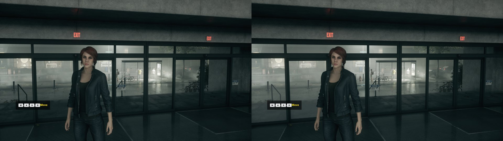

# Stereoscopic 3D: both eyes from one game update

> **Status:** 3D runs with all ray-tracing effects on and stays 3D through level changes: the right
> eye shares the left eye's acceleration structures (`as_once` 16, rayblaster r50/r51: 10 min in the
> world, 15+ teleports, a checkpoint restart, with and without 4x FG, no GPU fault). See "Shared
> acceleration structures" and, for the history, "Level-change hang". All
> temporal history is per eye by default now (`history_mask = 63`, measured r38). The HDR HUD is in
> both eyes by default (`hdr_hud_wide`). Frame generation (2x-4x, SDR and HDR) runs together with 3D,
> per eye (measured rayblaster r2-r9, RT off): "Stereo with frame generation". World-anchored HUD
> markers sit at the depth of what they mark and the pause menu keeps a 3D background (branch
> `wip/stereo-ui-depth`, measured on rayblaster `control-ui`): "The UI layer".

Threshold renders Control's world twice per game update, once per eye, inside one engine frame,
and composes them side by side. The design follows Torchbearer's (Alan Wake Remastered,
`~/code/torchbearer/docs/stereo.md`, "TB" below). The options and output modes mirror TB's.
Code: `src/features/stereo/` (`stereo.cpp` modes, hooks, composition, output; `eyestate.cpp` per-eye
state; `gpu.cpp` captures, the HUD draw duplication and the mono duplicate at Present; `window.cpp` the
full side-by-side window; `engine.h` every RVA and signature). Static background: [`re/stereo.md`](../re/stereo.md) and
[`re/dlss.md`](../re/dlss.md).

How each claim was established: "static" = read in Ghidra; "live" = observed in the lab (log, lab
verb or capture); "measured" = numbers from captures (`re/scripts/stereo_sbs.py`, patch matcher
`re/scripts/stereo_disparity.py` taken from TB). Lab instance `control-stereo`, 1920x1080 per
eye, GE-Proton11-12, RTX 5070 Laptop, the game's DLSS on (DLAA 1920x1080, preset K), RT on. Scene:
the start of the game (Continue on a fresh save, opening video and cutscene skipped): Jesse standing
in the Oldest House lobby, the reception desk ~4.3 m away, the wall emblem ~15 m.


*3840x1080 composite (downscaled), `mode = sbs`, 32.5 mm per eye, screen plane at 4 m: left eye
left, right eye right, the HUD hint in both halves.*

## What works

| | status | how established |
|---|---|---|
| Camera bias: `mode = left / right` | done | measured, below |
| Both eyes in one engine frame (`mode = sbs`), one Present per update | done | live, measured |
| Output `full` / `sbs` (2W swapchain, eyes 1:1) and `hsbs` (W swapchain, eyes squeezed 2:1) | done | live captures |
| HUD in both halves from one UI paint | done | live captures |
| Per-eye: previous camera, object motion, DLSS feature (and its reset), RT denoiser histories, SSR/AO/sun-shadow ping-pongs, volumetric light, TAA ring | done | measured (DLSS on r10; TAA ring with DLSS off r23) |
| Render-graph persisted resources (`lastcolorbuffer`, `previouslineardepth`) | per eye (with the RT reflection filter's output history, `history_mask = 63`) | measured r38: best of shared / per eye in the ghost zones, whole frame and disparity, see "Render-graph history" |
| TAA without DLSS (`m_eDLSSQuality: 0`) | done | measured r23 |
| `output = full` on a plain 2W-wide desktop: window widened, mouse per eye | done (borderless, windowed) | live, 3840x1080 lab display |
| HDR (FP16 scRGB swapchain): both eyes composed | done | live r24 (1046 pairs) |
| HDR: HUD in both eyes | done (`hdr_hud_wide`: the UI target 2W wide) | live, rayblaster r3/r15/r18 (r25's laptop hang was the wedged driver) |
| Separation, convergence (image shift in sbs, projection in left/right), swap eyes | done, live | measured |
| `mode = auto`, `output = auto`, Hyprland window tag, Quiver stereo layout | done | live in the lab only without Hyprland (auto → off/none); HypXRland not tested |
| Frame generation at the same time (2x-4x, per eye: two DLSS-G features, per-eye inputs, HUD-less from the side-by-side texture) | done | measured, rayblaster r4-r5, "Stereo with frame generation" |
| Level change (jump point / teleport, checkpoint restart) while in sbs | fixed (`as_once = 5`: the right eye skips the left eye's BLAS builds/compactions and runs its own new builds; `load_mono`: mono until streaming settles) | live, rayblaster r18/r19 (RT on, old as_once), r43 (22 teleports, RT reflections), "Level-change hang" |
| Ordinary play with RT on in sbs (the in-world GPU fault) | fixed (`as_once = 5`) | live, rayblaster r41/r42 (14 and 10 min in the world, every earlier 3D run faulted within ~3 min) |
| World-anchored HUD markers (interaction / collectible prompts, mission markers) at the depth of what they mark, or just in front of the surface hiding it (`ui_markers`) | done | measured, rayblaster `control-ui` r6, r12, r13, "The UI layer" |
| Pause menu over a per-eye background, the menu at the screen plane (`ui_pause`) | done (`full`/`sbs`; `hsbs` too, from the side-by-side texture) | measured, rayblaster `control-ui` r12 (and r13 with 2x FG), "The UI layer" |

Cost: two world renders per displayed frame. Measured (`quiver lab gpu`, 10 s windows, r12):
mono 81.4 / 61.2 presents/s, sbs 40.9 / 30.9 (two rounds; the ratio is 0.50 both times).

## How it works

### Frame structure (live)

- `RendererX86` slot 15 (`renderer+0x11daf0`, the world render), slot 17 (`renderHUD`), slot 18
  (`end`) and the Present all run on the "RMD - Renderer Thread" (census, one thread id). In the
  world there is one slot-15 call per frame; during Bink videos none (re/stereo.md Q1).
- In the world (and in menus, where `renderHUD` creates it) the scene and HUD go into the colour
  target `RendererX86+0x3c8`; the back buffer is untouched until `end` blits that target to it at
  (viewport offset, output size) with `copy.rfx/copyWithGamma` (live: back buffer in PRESENT state
  at `renderHUD` entry; static: `end` 0x134bb0). The target is the graph's final `colorbufferIN`,
  set by the Cleanup pass (static 0x134040; Q2).
- The camera: slot 15 gets the game's `m::View` by value. In gameplay `m00 = 1.5697`,
  `m11 = 2.7906` (16:9), view +x = camera right (live census; the opening cutscene uses 1.2598).

### One eye (`mode = left / right`)

The `m::View` argument is copied, its position moved along its own right row by ∓separation, and
re-derived with the exported `m::View::setViewToWorld` (rl); for convergence `viewToClip[2][0] +=
off·m00/Zc` through `m::View::setViewToClip`. The copy is passed to the original slot 15; shadow,
probe and reflection views are separate objects and are not moved.

### Both eyes (`mode = sbs`)

Per update, on the renderer thread:

1. Slot 15 runs twice with the left, then the right eye's view. After the left eye its final colour
   (+0x3c8) is copied to an eye texture.
2. Before the right eye, what `begin` prepares once per frame and a world render consumes is
   prepared again: `rend::SSAO`'s per-frame buffers (its vtable slot 1, `renderer+0x2434a0`; the
   RT pass's filter frees two of them after every render; without it the second render crashed on
   a null `+0x128`, live r4).
3. Visibility (culling) results: the game thread launches one culling query per `renderWorld`; the
   render pops one finished result per queue and returns the buffer to a pool of 2 (static
   `renderer+0x1b0300`, queues `+0x129bd70/+0x129bd10`). A second render waited forever for a
   second result (live hang, r6). The left eye's pops are kept and its returns held back; the right
   eye pops the same buffers and returns them (hooks on the queue pop/push, `renderer+0x1b3f20` /
   `+0x1b3fe0`). So both eyes use the centre camera's culling, as in TB.
4. `renderHUD`: both eyes are copied into a 2W x H texture from the engine's own render-target pool
   (`RenderTargetManager::allocTexture2D`, the colour target's format), each shifted for
   convergence; the HUD pass is then pointed at that texture and run **once**: the Coherent UI
   paints only once per frame (live: a second `renderHUD` drew no UI), so while it runs every draw
   recorded on the engine's command list is issued a second time with viewport and scissor moved
   right by W (hooks on the shared D3D12 command-list vtable, armed only for that call; TB's
   approach). Live r11: ~1300 duplicated draws per 700 frames, the hint box identical in both halves.
   In HDR the UI is painted into a separate RGBA8 target allocated per call at the output size
   (`RendererX86::pSeparateHudColorTarget`) and composed over the colour target by a compute pass
   (`copy.rfx/composeSceneAndUI`) dispatched over the *colour target's* size (static, renderHUD
   0x1343b0). The compose already covers our 2W texture; only the UI target was one eye wide, so the
   duplicated draws fell outside it (live r24: HUD in the left eye only). Making that one allocation
   2W wide during our call (dev `hdr_hud_wide = 1`, a hook on `RenderTargetManager::allocTexture2D`
   by name) hung the GPU within ~60 pairs (r25), so it is off and the HDR HUD is in the left eye only.
5. `end`: the side-by-side texture is put in +0x3c8 and the output size set to 2W for the call, so
   the engine's own blit (gamma included) draws both eyes into the 2W back buffer (`full`, `sbs`).
   With `hsbs` the output size stays W and the same blit samples the 2W texture into W: its
   bilinear fetch at exactly 2:1 averages each pixel pair (a box-filtered squeeze).
6. Frames without a pair (stereo off, menus, videos) with a packed output: `end` blits the one
   image into both halves (2D in the glasses).

All copies are recorded on the engine's own current command list through its exported
`d3d::NativeTextureUtil::copyRegion` (which does the engine-tracked state transitions). An earlier
build recorded them on our own lists after the engine's `submitGraphicsCommandList` "kick": the
halves came out swapped (measured: left half matched the right-eye mono capture to 0.01 px), i.e.
our copies were not ordered with the engine's final passes (Q3: the engine submits from more than
one list).

The CRT `rand()` is replayed for the right eye (TB's mechanism): the tonemap noise offset
(`g_vTonemapNoiseOffset`, static `renderer+0x22cf50`) is drawn per render. Measured r12,
separation 0: |L−R| mean 1.38-1.41/255 without, **0.15-0.27/255** with (pixels > 2: 21 % → 1-3 %).
What remains is on edges (the two DLSS features' antialiasing) and a lamp glint.

Two more things run once per render that must run once per update (static, this round):
- **DLSS reset**: the flag `renderer+0x128d1e6` is raised by `begin` (feature re-created, settings
  changed) and by slot 15 on a camera cut, and cleared right after `doAntiAliasing` (renderer
  0x13f581 / 0x1300e6). A reset raised in `begin` reached only the left eye's feature; it is now
  replayed for the right eye's feature (`reset_replay` in `stereo status`; static, no reset from
  `begin` was provoked live). A cut's reset is raised
  again by the right eye's own slot 15 call.
- **World video textures**: each render's "VideoDecoderStart" pass (renderer+0x123880) calls the
  exported `VideoStreamerFactory::updateAsync`, which starts a Bink decode job that "Scene update"
  waits for. The right eye's call is skipped (its wait finds the left eye's finished job;
  `video_skip`). This did *not* fix the level-change hang (open issues).

### Per-eye temporal state (`eyestate.cpp`)

The left eye uses the engine's own state, the right eye a second set swapped in around its render.

| state | what | how |
|---|---|---|
| previous camera (camera motion vectors, `g_m*Previous*`) | main `rend::View` +0x3d0/+0x450/+0x4b0 | each eye's current matrices kept after its render and put back before its next one (static: `storePrevious` 0x180700 from `end`) |
| object previous transforms (object motion vectors) | Cleanup pass copies Object +0x70 → +0xa0 only when the high-res-screenshot tile index == count (`renderer+0x802978/7c`) | inside the left eye's Cleanup pass only, the count is index + 1 (a non-final tile; `tile_hold = 2`, hook on renderer+0x134040): both eyes see last update's transforms; the right eye advances them. The ambient probe (renderer+0x211c80, the count's only other reader) runs in both eyes; holding the count for the whole left render (`tile_hold = 1`, before) skipped it there and left the left eye's forward-lit transparents and particles unlit (below, "Left eye: unlit glass and leaves") |
| DLSS history | `DLSSData+0x28/+0x30` (d3d `0x111be0`) | a second NGX feature created from the engine's own create parameters (sizes, quality, flags, preset hints) through the game's exported NGX entry points, swapped in for the right eye; re-created when the engine's feature changes, released 3 presents after its last use |
| RT denoiser (DLF) histories | 4 globals `renderer+0x90eac8, 0x912b18, 0x910b98, 0x90eb98`, and the reflection filter's output history `0x912b20` (bit 32, paired with `0x912b18`) | pointer swap (the filters allocate on null; static) |
| SSR / AO / sun-shadow temporal | `rend::SSAO` (r+0xd8) ping-pong pairs +0x100..+0x138 | pointer swap; its prepare allocates the right eye's |
| volumetric light | r+0xe8: +0x18 history, +0x40..+0x70 remembered camera | swap (history null falls back to the current buffer) |
| TAA ring (DLSS off) | SSAA r+0x138, 3 slots of {view, texture} | block swap; the right ring starts as a copy with no textures (the resolve allocates them) |
| render-graph persisted resources | vector `renderer+0x910c20` | the whole list swapped per eye (`history_mask` bit 1; measured best with bit 32, "Render-graph history") |

Measured (r10, 32.5 mm, parallel; reference = the mono-frame `left`/`right` pair of the same run,
per-patch disparity of each capture's halves vs the reference's):

| variant | median of all patches | far field (y < 500) | per patch vs reference: median / mean \|diff\| |
|---|---|---|---|
| reference (mono-frame left / right) | +9.13 px | +6.98 px | |
| **per eye** (default), 3 captures | +8.97 .. +9.07 px | +6.96 .. +6.98 px | **−0.006 .. −0.008 / 2.5-4.0 px** |
| everything shared (`per_eye = 0`) | +7.83, +7.87 px | **+4.32 px** (−38 %) | −0.43 / 5.0-5.2 px; 30 % fewer confident patches |
| per eye but one DLSS feature (`dlss_per_eye = 0`) | **+0.008 px** | +0.01 px | −9.3 / 15.8 px |

With one DLSS history and per-eye motion vectors the right eye's vectors say "no motion", so DLSS
keeps the left eye's accumulated image: the halves become identical. With everything shared the
eye switch reads as camera motion and the far field loses 38 % of its disparity. Per eye the field
matches the mono-frame one patch by patch (the mean |diff| is the player's idle motion between
captures; static regions match to ±0.1 px).

## Measurements

Disparity `K = 2·e·m00·W/2` = 97.95 px·m at 32.5 mm, m00 1.5697, W 1920.

- **Mono-frame bias** (r3, `left` vs `right`, separate frames): parallel field depth-consistent:
  player 50.7 px (1.9 m), desk 22.0 px (4.45 m), emblem 6.4 px (15.3 m). Two consecutive mono
  frames: median 0.02 px. Convergence 4 m in the projection: each eye shifted uniformly by
  −12.21 / +12.20 px (expected 0.0325·1.5697/4·960 = 12.24); parallel − converged 24.4 px on static
  regions → Zc = 4.0 m.
- **Same update** (r10-r12, `sbs`, 3840x1080 captures of the presented buffer): per-patch match
  with the mono-frame pair, above. Separation scaling (r12, one frame each): per-patch ratios
  32.5/16.25 = **2.000**, 65/16.25 = **3.996**, 65/32.5 = **2.000**. `swap_eyes` at 65 mm:
  −15.21 px against +15.17.
- **Convergence in sbs** (image shift, r10): parallel − converged per patch **24.01 px** (24 px
  applied: the 24.49 px total rounded and split 12/12) → Zc = 4.08 m for 4 set.
- **hsbs** (r13): 1920x1080 swapchain, both eyes squeezed, HUD in both; disparity in squeezed
  pixels 4.07 px median (full width 9.07).
- **FG enabled** (r14, before frame generation was combined): `stereo: [fg] enabled = 1: stereo stays off`.
  Now both run: "Stereo with frame generation".
- **Inert** (r17, shipped defaults, no Hyprland): `output auto -> none`, mode resolves to off; the
  hooks pass through and no GPU resources or command-list hooks are created.
- Live switching sbs ↔ off ×4 (r15): right-eye DLSS features created 3, released 2 (+1 in use),
  game alive.

### Render-graph history (`lastcolorbuffer`, `previouslineardepth`)

**What the list holds** (static, renderer 0x11ee20 graph builder / 0xa09a0 executor; live `stereo
graph`). Resources declared persistent are appended at the end of each graph run to the vector at
`renderer+0x910c20` ({ptr, u32 count, u32 capacity | 0x40000000 "not owned"}, entries 0xa0: +0 name
hash (FNV-1a 64), +0x10 `Texture2DInit`, +0x88 type, +0x8c flags, +0x90 resource). At the start of
the next run, type-2 alias entries claim a previous entry by name, everything unclaimed is freed,
and the count is reset. In the lobby the list has exactly three entries (live, hashes matched
against the renderer's strings):

| entry | format | read next frame as |
|---|---|---|
| `lineardepthcopy` (hash `ca970354…`) | R16_FLOAT, render size | `previouslineardepth` (`g_tPreviousLinearDepth`: RT pass, TAA) |
| `colorBufferCopy-2` (`25e4aa95…`) | R16G16B16A16_FLOAT, render size, mips | `lastcolorbuffer` (`g_tPreviousColor`: SSR, which builds its mips, RT reflections, "Final-image binding place") |
| `color_dlss_aa` (`286037ba…`; `color_taaout` with TAA) | R10G10B10A2, output size | nothing: persisted only so the final colour outlives the graph (Cleanup puts it in +0x3c8 for renderHUD/`end`); freed unclaimed by the next run |

**The black right eye of r9 is not reproduced.** A list that starts empty gives the two aliases a
null resource for one frame (the executor never allocates a type-2 entry), which is also the
engine's own first frame. There is no auto-exposure history in the list: the "autoexposure" pass
keeps its state outside the graph (static), so the earlier "exposure history starting at zero"
guess is refuted. Live: per-eye lists from launch (r19, cinematic and gameplay, 7351 pairs), switched
on live in the world (r18), and r9's exact bisect sequence replayed (`history_mask` 31, 1, 2, 4, 8,
16, 0, 1, 31; r19) all render both eyes. r9's build is gone; whatever made it black is not in the
current code.

**The ghost's partner: the RT reflection filter's second history (bit 32). Everything per eye is
now the default (`history_mask = 63`).** `rend::DeferredLightFiltering::filterSpecularNoise`
(renderer+0x15bd0, static) keeps two textures named `m_pColorHistory`: the input history
`g_DLF_tInputHistory` (0x912b18, swapped per eye before) and the output history
`g_DLF_tOutputHistory` (0x912b20, was not). It reprojects the reflection history with the previous
linear depth. With per-eye depth (bit 1) and a shared output history, each eye reprojected the
*other* eye's reflections with its own depth: the ghost of the other eye's Jesse. The filter treats
the pair as one: a non-null input history means "both exist" (a null output history then crashed,
live r32), and a null one makes it allocate both and free the current output history. So bit 32
swaps 0x912b20 only together with bit 2, and a new right-eye output history restarts the input one.

Measured (rayblaster r38, SDR, lobby photo mode, 32.5 mm, parallel, DLSS DLAA; mean |diff| to the
mono-frame reference /255, two captures per variant; two rounds, the second in reverse order; ghost
zones from the per-eye-graph-minus-shared difference as before, ~8% of each eye):

| variant | ghost zones L / R | whole frame L / R | disparity vs reference, mean \|diff\| |
|---|---|---|---|
| `30`: graph list and reflection output history shared (old default) | 3.05 / 3.13, 2.97 / 3.10 | 1.510 / 1.531, 1.496 / 1.526 | 1.85-1.89, 1.71-1.79 px |
| `31`: graph list per eye, output history shared | 3.43 / 3.47, 3.35 / 3.40 | 1.526 / 1.536, 1.518 / 1.534 | 1.79-1.94 px |
| `62`: graph list shared, output history per eye | 2.12 / 2.26, 2.03 / 2.19 | 1.377 / 1.407, 1.362 / 1.397 | 1.14-1.17, 1.20-1.23 px |
| **`63`: everything per eye (new default)** | **1.95 / 1.99, 1.88 / 1.94** | **1.346 / 1.353, 1.336 / 1.348** | **1.00-1.20, 1.17 px** |

So the shared output history was most of the error (30 → 62: −32% in the ghost zones, −10% over the
whole frame, −37% disparity error), and with it per eye the per-eye graph list now helps instead of
ghosting (62 → 63). Script: `RB=rayblaster re/scripts/stereo_ab.sh control-stereo OUT -n 2 m30:history_mask=30 ...`
after `re/scripts/stereo_rb_photo.sh` (driven in `mode = off`, then switched live).

Before that (r20, laptop), with the output history still shared, per-eye lists measured worse than
shared, and crossing only the depth (`graph_cross = 1`) removed the ghost:

| variant | ghost zones L / R (mean \|diff\| to the mono reference, /255) | whole frame L / R | disparity vs reference: median / mean \|diff\| |
|---|---|---|---|
| shared list (`history_mask = 30`) | 1.13 / 1.23 | 1.576 / 1.603 | −0.036 / 2.44 px |
| per-eye lists (`31`) | 1.57 / 2.02 | 1.619 / 1.616 | −0.060 / 2.72 px |
| per-eye, depth content crossed (`31`, `graph_cross = 1`) | 1.15 / 1.23 | 1.577 / 1.600 | −0.038 / 2.49 px |
| per-eye, colour content crossed (`graph_cross = 2`) | 1.54 / 1.97 | 1.594 / 1.602 | |
| per-eye, both crossed (`graph_cross = 3`) | 1.12 / 1.23 | 1.576 / 1.600 | −0.037 / 2.44 px |
| everything shared (`per_eye = 0`) | 2.00 / 1.77 | 3.468 / 3.858 | |

Earlier lobby captures with the player idling (r18, not frozen): per-eye vs shared, reflective floor
regions away from the player within ±0.1/255 of each other, disparity vs reference 3.67-3.80 vs
3.89-3.93 px mean |diff| (player animation dominates).

### The full side-by-side window (`output = full`, `window.cpp`)

The game's window is `app::WindowX86` (app_rmdwin10_f.dll; imported and analysed for this, static):
+0x20 HWND, +0x3c/+0x40 the client size the engine renders at, +0x147 set while its own
create (slot 1, app+0x5100) / resize (slot 8, +0x5660) / borderless (slot 11, +0x6000) call
SetWindowPos (its WM_WINDOWPOSCHANGING then forces that size), +0x230 borderless. Monitor rectangles
come from its own list (`app+0x20de8`, MONITORINFOEXA), refreshed by `app+0x4c90` before each use and
read by the exported `app::getMonitorInfo`. Absolute mouse positions are normalised by the real
client rectangle (WM_MOUSEMOVE `app+0x6c20`, the cursor getter `app+0x6b30`).

With `output = full`:
- a monitor at least 3x as wide as tall (a doubled 16:9 desktop) is reported half as wide (hook on
  `app+0x4c90`), so borderless sizes the engine to one eye;
- the window is subclassed (`SetWindowLongPtr`, no function hook) and widened to a 2W client on its
  own thread (a posted message; never from the renderer thread); WM_SIZE reaches the engine as W;
  when the engine's own resize sets it back to W it is widened again;
- absolute mouse x reaches the engine as the position within the eye under the cursor
  (`x mod W`), WM_MOUSEMOVE and the cursor getter alike; relative (mouse-look) input is untouched;
- a 2W client that would not fit the monitor is not attempted (a 1920 desktop keeps the squeezed
  view; live r23/r24: a 3840 window on the 1920 gamescope output showed black).

Verified live on a 3840x1080 lab display (instance `control-stereo-wide`, runs r1-r5):
- Borderless (`m_eWindowMode 1`, r1): `engine 1920x1080 (borderless), client 1920x1080 -> 3840x1080
  at 0,0`, monitors halved 2; the gamescope output shows both eyes 1:1 over 3840 (no squeeze).
- Windowed (`m_eWindowMode 0`, r4): `engine 1920x1080 (windowed), client 1920x1080 -> 3840x1080`;
  title screen in both halves 1:1.
- Mouse (r1, pause menu): the cursor at (2052, 582), over "Photo Mode" in the right half, highlights
  "Photo Mode" in both eyes; at (132, 497), left half, "Options".
- Mouse-look unchanged: 200 px of relative motion turned the camera 33.3° and 100 px pitched it
  17.0° (0.166 vs 0.170 °/px: horizontal not halved by the 2x client).
- **Exclusive fullscreen** (`m_eWindowMode 2`, r2, r5) stalls at the title screen (renderer idle,
  game thread stuck) with or without the window subclass, so it is the 2x swapchain in exclusive
  mode, not this code; the subclass is skipped when the swapchain is fullscreen. Use borderless.

### TAA without DLSS (`m_eDLSSQuality: 0`)

r23, frozen photo mode, lobby, 32.5 mm parallel (`dlss.on: false` in `stereo status`; the right eye's
TAA ring swapped, `history_mask` bit 16):

| variant | disparity, median of all patches | vs mono reference: median / mean \|diff\| | separation 0: \|L−R\| mean, % > 2 |
|---|---|---|---|
| per eye (default) | +19.96, +19.97 px | **−0.07 / 1.90 px** | **0.082**, 0.69 % |
| TAA ring shared (`history_mask = 14`) | −0.001, +0.005 px | −20.0 / 17.4 px | 0.153, 0.94 % |
| everything shared (`per_eye = 0`) | +0.015, +0.016 px | −20.0 / 16.4-16.6 px | 0.166, 0.87 % |

Like one DLSS history, one TAA ring makes the halves identical (the resolve reprojects the shared
history with each eye's own stored ring views and converges to one image): the per-eye ring is
required and works. Against the mono references the per-eye halves differ by 1.40 / 1.02 (whole
frame, /255) vs 2.23 / 1.46 with the ring shared.

### HDR

Lab instance `control-stereo` with `display.hdr=on` (gamescope HDR10 PQ), renderer.ini
`m_eAllowHDR 1`, DLSS DLAA. The game's swapchain is R16G16B16A16_FLOAT (`swapchain … fmt 10`),
scRGB; the side-by-side texture follows the colour target's format (engine format 23, FP16).

- Composition (r24, 1046 pairs, no stall): the 2W back buffer captured raw (`stereo shots 1
  TAG_raw`, 3840x1080 FP16): both eyes present with the expected disparity, no NaN/Inf, channel
  max 3.12 (≈250 nits at 80 nits per 1.0), mean 0.14; `quiver lab shot --hdr` (the 1920 gamescope
  output) max 251 nits, p99 146, 0.2 % above 203 nits paper white.
- Menus and the title screen (no pair): `end`'s mono duplicate puts the menu in both halves.
- **HUD: left eye only.** In HDR the engine paints the UI into a separate one-eye-wide RGBA8 target
  and composes it with a compute pass over the colour target; our duplicated draws land outside that
  target. The compose is dispatched over the colour target's own size (2W), so a 2W UI target is all
  that is missing; allocating it 2W (dev `hdr_hud_wide`) made the GPU stop ~60 pairs later (r25:
  the renderer thread blocked in vkd3d inside our next `copyRegion` in `end`; no `signaller_worker`
  timeouts that time). Not investigated further: the UI target is bound together with the
  one-eye-wide depth buffer `renderHUD` allocates (`RenderToTexture(target, depth)`), and draws past
  the depth buffer's extent are a plausible GPU fault; the SDR path binds our 2W texture with that
  depth buffer too and is fine, so this is a guess. Next: also allocate that depth buffer 2W, or
  compose the UI ourselves into the right half from the UI target before it is freed.
- Per-eye output: captures are linear FP16; `stereo_sbs.py raw` decodes them (also R11G11B10 and
  R10G10B10A2), and BMP captures of FP16 are now clamped and gamma-encoded instead of garbled.

### The UI layer: world markers and the pause background (`ui.cpp`)

The user's report on a HypXRland XReal display (2026-11-23): world markers (collectible hints,
objective markers) sat at the screen plane with the rest of the HUD, and the pause menu's frozen
background was the same flat image in both eyes. Both are fixed on `wip/stereo-ui-depth`; the
approach follows Pharos (`~/code/ac-dlss/docs/STEREO.md`, "Predator Bow and tracked markers"): the
game's own world positions for the markers, a depth probe along the camera ray for obstruction,
and a per-eye shift of the marker's sprites.

**How the HUD is drawn (static: ui_rmdwin10_f.dll in Ghidra; live: `stereo ui dump N`).** The HUD
and menus are Coherent GT. renoir records each view's paint; `ui::UIRendererBackend` (ui dll,
vtable slot 24 `ExecuteRendering`, ui+0x32080) executes it on the renderer thread inside
`renderHUD`, where gpu.cpp already repeats every draw in the right half. Per draw the backend sets
the vertex constant "Transform" (ui+0x2c1a0, type 0, a row-major float4x4) and binds textures
(ui+0x2cd40, `txBuffer0..3`); render targets go through the d3d export `setRenderTargets`. Coherent
paints each animated element into its own small layer texture (64x64, 64x128, 320x128, ...) and
composites it into the colour target with one textured quad whose Transform translation is the
element's position: live, x = T[3] x viewport width, y = T[7] x viewport height, within ~5 px of the
anchor's projected position (r5: 15 frames while turning, T[3] tracked the projection at 1/3840 per
px in the 3840-wide side-by-side viewport). Static parts are cached in one 1920x1088 layer.

**World markers.** The HUD projects every world-anchored widget with one function,
`Control_DX12.exe+0x5edb50` (static: called by the mission marker update exe+0x621410, the
interaction marker update exe+0x605180 and other widgets): it takes the anchor and an offset, projects
with the game camera (16:9), clamps an off-screen point to the safe-area edge and returns the UI
pixel position. A hook keeps the world point and the result of each call (ring of 128, game
thread). Per side-by-side HUD pass (renderer thread):
- each anchor projected in the last 3 frames becomes a marker; its depth is the anchor's distance
  along the centre camera's forward axis (the pair's `m::View`);
- the first surface on the ray: one texel of the left eye's linear depth (the render graph's
  persisted `lineardepthcopy`, R16_FLOAT, metres: live, the checkpoint marker's ray read 23.3 m on
  the wall behind its 18.2 m anchor) at the anchor's position in the left eye's image, copied on the
  engine's list at the HUD's first draw into a readback ring, read 3 passes later;
- the marker's depth z is the anchor's, or 0.97 x the surface's when the surface is nearer (an
  obstructed marker sits just in front of the occluder); edge-clamped markers use the surface at the
  clamped point; the per-eye shift is the scene's disparity at z, `±e·m00·W/2/z` plus the eye's
  convergence image shift (or minus `e·m00·W/2/Zc` with projection convergence);
- a draw composited into the 2W target whose texture is at most 256x256 and whose Transform position
  is within 56 px (x) / 80 px (y) of a marker gets that marker's shift: gpu.cpp issues the left and
  the right draw with their viewports moved by the eye's shift (fractional) and the scissor kept in
  the eye's half.

Measured (rayblaster `control-ui`, display 3840x1080, `output = full`, 1920x1080 per eye, DLAA,
RT on, 32.5 mm, convergence 4 m; `re/scripts/stereo_marker.py` on screenshots: the marker's bright
pixels' centroid in each half vs patch matches of the scene around it; disparity = x_left - x_right):

| case | marker | disparity of the marker | scene next to it |
|---|---|---|---|
| r6, lobby, checkpoint interaction marker, visible (anchor 18.2 m, surface behind 23.3 m) | at the anchor | **-18.64 px** (expected -18.62) | the red lamp beside it -18.64, -18.56 px; the desk below -17.85 px |
| r12, the same marker over its sign (anchor 17.0 m, the sign's surface 15.2 m) | obstructed: 0.97 x 15.2 = 14.7 m | **-17.21 px** (expected -17.34) | the sign -17.84, -18.04 px (the marker is just in front) |
| r13, `[fg] count = 2` (projection convergence), the visible marker | at the anchor (18.2 m) | **-19.08 px** (expected -19.10) | the lamp -19.06, -19.06 px |
| r16 (final build) and r17 (merged with main 577bde0): on / `ui_markers = 0` live / on again after a pause | anchor (18.2 m) / screen plane / anchor | **-18.76 / 0.00 / -18.76 px** | -18.62, -18.60 px |
| before (main) | screen plane | 0 px (identical in both halves) | |

Off-screen interaction markers are not drawn by the game (r12: the projection clamps, no edge arrow
appears). No mission marker was on screen at the `game-start` story point, so mission markers and
edge arrows were not seen live; they go through the same projection and composite path (static).

**Pause background.** `renderHUD`'s pause frames (no world render) draw the menu over a frozen
frame. That frame is RendererX86 slot 22 (renderer+0x135840, static): it copies the back buffer at
(viewport offset, the texture's size) into a game-owned texture, once, on the frame the menu opens
(live r5: the only full-frame copy, from renderer+0x135901); every paused frame the engine's
ShapeEngine then draws that texture full screen (one 6-index draw outside the UI backend; live r6:
swapping the texture's content around that draw's right-half copy changes the right half's
background), and the Coherent menu composites over it. With the 2W back buffer the copy took the left eye only, and the
mono duplicate showed it in both eyes.
Since the laptop freeze (below) the design is (branch `wip/stereo-ui-pause-fix`):
- Slot 22 is hooked only to note the capture; nothing is allocated, copied or written there.
- The side-by-side texture keeps the last pair: frames without a pair (menus, videos, the first
  paused frames) are duplicated into a second 2W texture (`Threshold::stereoMonoDuplicate`) instead
  of over it.
- The first paused frame (no world render after a capture) copies the side-by-side texture, i.e. the
  last pair with its HUD as presented minus `end`'s gamma blit, into one 2W texture of ours, at the
  start of `renderHUD`, where the pair path also allocates and copies.
- Paused frames run `renderHUD` over the side-by-side texture with the draw duplication armed, like a
  pair. `renderHUD` first clears it (+0x474 and +0x475 are both 1 in these frames, live r20); the
  engine's background quad (the first full-screen 6-index draw outside the UI backend) is skipped in
  both halves and our copy is put in its place, on the engine's list at that point, so the menu
  composites over both eyes. The menu is drawn twice at the same position: the screen plane. `end`
  blits it like a pair. No game texture is written.
- Ends at any world render, at a load (`onIsLoading`), and after 30 paused frames in a row without the
  background draw (the first paused frames draw nothing at all, live r5).
- `output = hsbs` needs nothing special now: both eyes come from the side-by-side texture, 1:1.
- Brightness: the copy is the pre-gamma frame and the engine's background was the back buffer. The
  pause dims the wall to 0.600 (`full`, r21) / 0.599 (`hsbs`, r19) of the world's brightness, as the
  engine's own pause did (0.600, r12), so `end`'s blit is an identity here (SDR, default brightness;
  HDR not tested).

Measured (r12, lobby, the same capture conditions; `stereo_disparity.py` per half):

| capture | background (x 500-1880): median, p5..p95 | wall: median | menu "Resume Game" button: best shift, \|L-R\| at 0 |
|---|---|---|---|
| in the world before pausing | -16.11 px, -23.9..+20.0 | -18.12 px | (no menu) |
| paused, `ui_pause = 1` | **-16.39 px**, -19.9..+19.5 | **-18.14 px** | **0 px, 0.00/255** |
| paused, `ui_pause = 0` (main's behaviour) | -0.00 px | 0.00 px | 0 px, 0.00/255 |
| r13, 2x FG: in the world / paused | | -18.68 / **-18.69 px** | menu in both halves (screenshot) |
| r16 (final build) / r17 (merged with main), paused | | **-18.11 / -18.14 px** | 0.00/255 both |

| `wip/stereo-ui-pause-fix` (r21 `full`, control-ui), in the world / paused | | -18.08 / **-18.12 px** | 0.00/255 |
| `wip/stereo-ui-pause-fix` (r19 `hsbs`, control-ui1080: 1920x1080, DLSS Balanced 1114x626), world / paused | -8.44 / **-8.48 px** (squeezed) | | 0.00/255 |

The menu is identical in both halves; the background keeps the world's disparity field.

**The laptop freeze (2026-11-23, main 5324374, v5).** The user's game froze for good right after
`stereo ui: pause background captured per eye (1920x1080 format 20)`, the run's first capture, on
picking up a memo (`output = hsbs`, FG off, DLSS Balanced, RTX 5070 Laptop 8 GB): no present after it,
GPU idle, one `vkd3d_queue` thread waiting on a timeline value nobody signals (a wait-before-signal on
the GPU side, no Xid).
- **Not reproduced in the lab.** The document reader never opened there: three documents picked up at
  the `game-start` story point (hub security desk, NSC control room twice; rayblaster
  `control-ui`/`control-ui1080` r1-r3) were collected without a reader and without a capture; Esc
  pause in `hsbs` at the user's resolution and DLSS mode, three times in a row, did not hang (r2).
  The capture's caller is the same for every menu (`Control_DX12.exe+0x568f70`, "Screen shot
  texture", static; live caller `exe+0x5690f2` for Esc, r4), so the reader's capture is the same call.
- **What main's capture path did that the reader can reach and Esc did not:** inside slot 22 it
  allocated two pool render targets and recorded three copies, in `hsbs` from the side-by-side
  texture pointer saved at the last pair (`end` reallocates that texture when a frame's colour target
  changes format: a dangling pointer if a frame without a pair came between); and on every paused
  frame it copied textures into the game's "Screen shot texture" around every draw outside the UI
  backend (one per frame for Esc; unknown for the reader). It also kept the pause state through
  loads (r5: 1557 paused-path frames during a teleport's load, ended only by the next pair). The
  rework removes all of these; which one hung the laptop is not established.
- **Also found:** a frame without a pair before the capture had overwritten the side-by-side texture
  with the mono image (the first rework drew a black background, r18-r20), hence the mono texture.

## Stereo with frame generation

Both run at once: `[fg] enabled = 1` with `mode = sbs` and a packed output. Approach 2 of the former
design, per eye: two DLSS-G features, each fed its own eye's depth, motion vectors, jitter, camera and
HUD-less colour, each evaluated in its eye's half of the shared 2W textures. Code: `src/features/fg/fg.cpp`
(`frame_views`, `evaluate`), `engine.cpp` (HUD-less, `camera_crop`), stereo's side in `stereo.cpp`
(`fg_stereo_link`, `fg_stereo_hudless`, `fg_stereo_frame`; FG's API in `fg.h`). How FG itself works:
[`fg.md`](fg.md), section "Stereo".

How it fits together (static, from the code; every point verified live below):
- **Inputs per eye.** Each eye's world render evaluates its own DLSS SR feature (the engine's for the
  left eye, `eyestate.cpp`'s for the right). FG's Eval tap asks stereo which eye it is in (the pair's
  phase on the renderer thread) and keeps one depth/MV copy, jitter, MV scale and camera per eye. The
  camera is read inside that eye's render, so it is the eye's moved view with the eye's own previous
  matrices (per-eye `storePrevious`, "Per-eye temporal state").
- **Two features.** DLSS-G keeps the previous frame inside the feature; one feature evaluated for both
  eyes interpolates between the other eye's previous image and this eye's (measured below:
  `stereo_features = 1`). Feature 0 is the left eye's, feature 1 the right eye's, both created at one
  eye's size.
- **Sub-rectangles** (`DLSSG.InputBackbufferSubrect*`, `OutputInterpolatedSubrect*`,
  `HUDLessSubrect*`, `DepthSubrect*`, `MVecsSubrect*`; names from
  `third_party/DLSS-310.9.16/include/nvsdk_ngx_defs_dlssg.h`): the left eye x 0..W, the right eye
  W..2W, of the one 2W real frame, HUD-less copy and output texture; depth and MVs are each eye's own
  render-size textures. `DLSSG.EvalFlags = UpdateOnlyInsideExtents`: by default DLSS-G also writes the
  uninterpolated backbuffer *outside* the sub-rectangle, which would overwrite the other eye's half.
- **HUD-less.** Stereo hands FG the side-by-side texture after both eyes are copied in and before the
  HUD is drawn (`fg_stereo_hudless` in stereo's `renderHUD`). FG's own renderHUD tap then leaves the
  copy to it (it would otherwise copy the one-eye colour target). The FG tap is a vtable patch that
  chains into stereo's inline detour of the same function; its signature check now accepts a body
  that jumps into our own module, which is stereo's detour.
- **Layout per frame.** Stereo's `end` reports each packed frame (`fg_stereo_frame`: pack, eye width,
  shifts, pair or mono duplicate). A frame without a pair (one image in both halves) gives both views
  the one input set. A frame stereo doesn't report is evaluated whole, as without stereo.
- **Convergence goes into the projection while FG is linked.** DLSS-G refuses a backbuffer
  sub-rectangle narrower than the feature (`0xBAD00005`, live r2). So with the image-shift convergence
  (the eye images moved by ∓12 px, uncovered columns black) each feature had to be created at the
  shown width (1908-1910 px) with depth, MVs and camera cropped to match (`camera_crop`). That works
  (measured r4, below), but the shift follows the game's animated zoom, so the features were
  re-created 9 times in the first 2 s of play (13-24 ms each, history lost), and would be again on
  every aim. The projection convergence measures the same here (below), so stereo uses it while FG is
  linked: no crop, features at the full eye width, created once. FG keeps the crop path for a
  reported shift.
- **Not linked** when the output isn't packed (`output = none`, the default off HypXRland): FG then
  runs exactly as alone.



*3840x1080 (downscaled), `mode = sbs`, `[fg] count = 4` (r5, 285 presents/s from 71 rendered with
another instance loading the GPU): left eye left, right eye right, the HUD hint in both.*

Measured on rayblaster (instance `control-sfg`: GE-Proton11-12, display 3840x1080@120 so `output =
full` widens the window to both eyes 1:1; renderer.ini DLSS Quality 1280x720 → 1920x1080 per eye,
**all RT effects off**, motion blur and film grain off; lobby from the `game-start` fixture; 32.5 mm,
convergence 4 m unless noted). Captures: `fg grab N TAG` (FG's verb: the real frame and every
generated frame of N consecutive jobs, whole, exactly what is presented) through `tools/fg/stereo-grab`
(optionally while `tools/fg/spin.py` turns the camera, 2 px of mouse-look per 2 ms), analysed by
`tools/fg/stereo-gen.py`. Per eye half: the generated frame's horizontal shift from R(n−1) over
R(n−1)→R(n) by phase correlation (expected k/m), its per-patch stereo disparity (L half vs R half)
against the real frame's, and as a baseline how much the real frames' own disparity field moves from
R(n−1) to R(n).

| run | config | shift ratio L / R (expected) | disparity median G / real | per-patch \|G − real\| median | baseline R(n−1)→R(n) |
|---|---|---|---|---|---|
| r4 s2x | 2x, image-shift convergence (crop 1908-1909 px) | 0.498 / 0.499, 0.502 / 0.498 (0.5) | −16.64 / −16.28, −16.38 / −16.25 px | 0.14, 0.16 px | 0.16, 0.20 px |
| r4 s4x | 4x, image shift | 0.257 / 0.242, 0.501 / 0.473, 0.753 / 0.746; 0.253 / 0.252, 0.499 / 0.504, 0.747 / 0.746 | −15.31 / −15.13 ... | 0.08-0.19 px | 0.19, 0.23 px |
| r4 c0pe | 2x, convergence 0, per-eye features | 0.501 / 0.501, 0.505 / 0.505 | 11.05 / 11.17, 10.86 / 10.88 px | 0.14, 0.16 px | 0.22, 0.26 px |
| r4 c0sh | **negative control**: one feature for both eyes (`[fg] stereo_features = 1`) | 0.494 / **0.959**, 0.510 / **0.966** | **23.19** / 12.17, **22.93** / 12.34 px | **17.6, 18.5 px** | 0.37, 0.40 px |
| r5 p2x | 2x, projection convergence (the default with FG) | 0.502 / 0.505, 0.510 / 0.504 | −14.40 / −14.40, −15.08 / −14.66 px | 0.41, 0.49 px | 0.46, 0.54 px |
| r5 p4xb | 4x, projection | 0.251 / 0.251, 0.500 / 0.501, 0.750 / 0.751 | −11.93 / −12.00 ... | 0.27-0.52 px | 0.65 px |
| r48 rt4x | 4x, projection, **all RT effects on**, display 1920x1080 (`control-stereo`) | 0.237 / 0.238, 0.475 / 0.476, 0.713 / 0.713 | −15.2 / −11.7, −14.9 / −11.9, −14.8 / −12.8 px | 0.82, 0.65, 0.42 px | 0.81 px |

r48 (`tools/fg/stereo-grab control-stereo OUT rt4x 2 2`, one job captured while turning): both eyes
sit at the same fraction of the step, the generated frames' disparity moves no more than the real
frames' own does between them, and each generated eye is nearer its own eye's real frame than the
other eye's (err same / other eye: 3.9 / 5.4, 3.3 / 4.9, 2.6 / 4.7 left; 3.9 / 5.8, 3.4 / 5.3,
2.7 / 4.8 right). The ratios sit ~5 % under k/m in both eyes alike (the turn was faster here than in
r5, at a lower rendered rate).

**Latency in 3D (rayblaster r49, under `quiver lab gpu`).** `tools/fg/latency` (docs/fg.md 8: 40
mouse-look injections, the first frame whose camera turned, ms after the input, median (p10–p90)),
run from a private copy of `tools/` on rayblaster (`~/threshold-lab-stereo`, `lat-series`: live
`quiver lab set` between cases, each case under the GPU lock, two rounds a/b). Instance
`control-stereo` (display 1920x1080@60, `output = full`), renderer.ini DLSS Quality, **RT off** (as in
fg.md 8), lobby, 32.5 mm. FG off = `[fg] active = 0` (same proxy path). Mono = `[stereo] mode = off`
in the same session (still the packed output: the one image copied into both halves). "fps" counts
DLSS evaluations, so in 3D it is two per displayed frame (pairs/s = half).

| case | evals/s | eval recorded | frame done (GPU) | first present | real present |
|---|---|---|---|---|---|
| 3D, FG off (a / b) | 147.3 / 146.3 | 15.0 / 14.8 | 19.5 / 19.1 | **17.8 / 17.4** (14.5–22.7) | 17.8 / 17.4 |
| 3D, 2x | 139.0 / 138.4 | 16.0 / 16.8 | 20.5 / 21.5 | **22.5 / 23.6** (19.6–27.1) | 26.1 / 27.1 |
| 3D, 4x | 128.7 / 128.8 | 18.2 / 17.6 | 24.8 / 24.1 | **28.2 / 27.5** (24.1–30.6) | 33.9 / 33.4 |
| mono, FG off | 208.1 / 209.3 | 12.1 / 11.8 | 14.1 / 13.6 | **12.9 / 12.3** (10.3–16.5) | 12.9 / 12.3 |
| mono, 4x | 176.7 / 177.5 | 14.0 / 14.0 | 16.3 / 16.5 | **19.7 / 20.2** (16.8–22.4) | 24.0 / 24.6 |

- 3D costs ~5 ms to the first present without FG (17.6 vs 12.6 ms): a pair takes two world renders
  (~73 pairs/s against ~209 mono frames/s), and the input lands in the left eye's render.
- FG adds the same kind of cost as in mono, scaled by the slower frame: +5.5 ms (2x) and +10 ms (4x)
  to the first present in 3D, against +7.3 ms (4x) in mono here; the real frame +9 / +16 ms.
- The same-session mono numbers are ~1 ms (off) to ~4 ms (4x) above fg.md 8's r7–r8 (11.9 / 16.2):
  another instance and display (60 Hz, the packed 2W output), not the same build's setting.

- **Each eye's generated frames are that eye's.** Both eyes interpolate at k/m, and the disparity of
  generated frames equals the real frames' to within the real frames' own frame-to-frame change.
  With one shared feature the right eye's "generated" frame is 96 % of the way to the next frame
  (it interpolates from the left eye's image) and its disparity is off by 18 px per patch: the
  metric sees cross-eye mixing when it is there.
- **Still scene** (no input; r4 s4still, r5 p4stillb, 4x): generated vs real of the same eye 0.03-0.40/255
  mean, vs the other eye's real half 5.8-11.4/255; disparity identical (median |diff| 0.00 px).
- One r5 p4xb triplet had ratios near 0 in the left eye at 1/4 and 2/4 (0.5 in the right at 2/4).
  It spans a 107 px jump between real frames (a hitch); the phase peaks were weak (0.09-0.12 vs >0.3
  normally) and both eyes' errors to R(n−1)/R(n) were equal (6.53/6.54, 8.73/8.77, 10.23/10.17): a
  measurement miss, not an eye difference.
- **HUD in both eyes** (screenshots r2 2x, r5 4x; captures): on the "W, A, S, D Move" hint's 3827
  glyph pixels, generated vs real 0.12-0.18/255 in each eye during the spin (r4 s4x), 0.05-0.09/255
  over the hint box when still.
- **Uncovered columns** (image-shift convergence, r4): columns 1908..1931 black in the real frame and
  in every generated frame (copied from the real frame). The 40 columns at each eye's inner edge have
  the same error against the real neighbours as the interior (6.24 vs 4.24 with a motion of 10.89 vs
  7.77, 3.51 vs 4.01; i.e. 0.57 / 0.55 / 0.69 / 0.57 of the real-to-real change): no seam bleed.
- **Convergence** (r4, still, 2x): parallel − converged, median disparity 7.18 − (−16.64) = **23.82 px**
  with the image shift, 7.18 − (−16.68) = **23.86 px** in the projection (expected 2·12.24 at 4 m).
  Generated frames carry the same disparity (|diff| median 0.00 px).
- **HDR** (r8: `display.hdr=on`, renderer.ini `m_eAllowHDR 1`; the game rendered at 1920x1080 per eye
  that run, i.e. DLAA; 4x): FP16 scRGB swapchain, both eyes' generated frames through FG's PQ
  conversion (`docs/fg.md` 6). Spin: ratios 0.252 / 0.252, 0.500 / 0.500, 0.747 / 0.745 and 0.246 /
  0.246, 0.491 / 0.491, 0.737 / 0.737; disparity |G − real| median 0.50-0.97 px against a baseline of
  0.67 / 0.94 px. Still: same eye 0.09/255, other eye 7.43/255. Generated FP16 frames have no NaN/Inf
  and the real frame's statistics (mean R 0.0852 vs 0.0853, max 2.49 both). HUD in both eyes: the
  hint's 3942 glyph pixels at 155 nits in each eye, generated vs real 0.005 (0.4 nits). Real fps were
  52-54 (DLAA, 4x, the other lab instance unthrottled; not a timing figure).
- **`output = hsbs`** (r9, smoke test; on this 3840-wide display the engine rendered each eye at
  3840x1080 and `end` squeezed them into 1920 halves of a 3840 swapchain): features at the half's
  width (1920), depth/MVs whole; ratios 0.497 / 0.499 and 0.473 / 0.475, disparity G / real −5.95 /
  −5.66 and −6.04 / −5.81 px. No HUD-less in hsbs (the side-by-side texture is 2W, the frame W).
- **Level changes with 3D + FG** (r10, SDR, RT off; `re/scripts/stereo_rb_fg_levels.sh`, run twice in the
  same session): 4x, 6 teleports (mail-room, executive-corridor, cafeteria, motel, dead-letters,
  entry-lobby) and a checkpoint restart, then 2x and 2 teleports; 20 level changes in all.
  - The FG features were created once per eye at start and never re-created or released (`CreateFeature(FrameGeneration` 2 in the log, 0 evaluate errors, `fail 0 dropped 0` after every
    change); pairs advanced throughout (9764 → 72325), multiplier 4.0 / 2.0 after each change.
  - Right after each change (the first jobs, `fg grab 2`, player idle): generated vs real of the same
    eye ≤ 1.08/255, vs the other eye ≥ 1.70/255 (dead-letters, a dark room; elsewhere 3.9-10.1),
    disparity of generated frames equal to the real frames' (median |diff| ≤ 0.02 px). Screenshots
    after every change: both eyes correct, HUD in both.
  - No Xid from this run. One `signaller_worker` timeout in its game.log at 07:42:20, one second
    before an `Xid 109` (07:42:21) of pid 899329, which was the other lab instance's game
    (`control-stereo` r42, RT on: 56 timeouts, relaunched at 07:45; this run's game was pid 1054272
    throughout). The second pass (07:47-07:53) added no timeout and no Xid.
- **Each alone is unchanged** (same build, r6/r7):
  - FG off, `mode = sbs`, `output = full` (r6): 22721 pairs, HUD in both halves, image-shift
    convergence ∓12 px as before (screenshot: the black seam columns), `fg status` enabled false, no
    FG texture or feature, no stereo link.
  - FG on, stereo at its defaults (`mode = auto`, `output = auto` → `none`, r7): stereo's hooks pass
    through (0 pairs), no link (`stereo_link` false, no `fg: stereo linked`), one DLSS-G feature over
    the whole frame, the HUD-less tap patched through stereo's pass-through detour (`HUD-less: ...
    patched`, HUD-less texture made): 165.7 + 165.7 = 331.3 presents/s at 2x, perf line as before (no
    per-eye field). Before this branch stereo installed no hooks at all with `[fg] enabled = 1`; now
    its hooks are installed and pass through, as they do whenever stereo is off.
- Feature creation (log): one per eye with projection convergence for the whole run (`CreateFeature(
  FrameGeneration 1920x1080 ...)` + `right eye`, 15-20 ms); 13 creations in r4 with the image shift.

**Frame rate and pacing** (r5, **each trace under `quiver lab gpu`**, which throttled the other lab
instance on the GPU, `control-stereo`; `tools/fg/fg-series control-sfg t1 ...` run on rayblaster, the
`fg trace` band spanning both eyes, its two phase-correlation sub-bands at 4-36 % and 64-96 % of the
width, i.e. one in each eye; `[fg] active = 0` is the same proxy path without generation; interleaved
off, 2x, 4x, off, 2x, 4x; spin ~3.5 px/ms):

| trace | rendered fps (both eyes per frame) | presents/s | DLSS-G done after the game's Present | present-call interval sd | shift ratio per index (sd) | position residual, VRR model mean / p90 |
|---|---|---|---|---|---|---|
| off / off2 | 136.1 / 132.6 | same | | 1.14 / 1.12 ms | | 3.97 / 8.20, 3.51 / 7.40 px |
| x2 / x2b | 121.8 / 128.3 (perf 126-131) | 243.5 / 256.7 (perf 253-262) | 2.48-2.50 ms | 0.67 / 0.69 ms | 0.500 (0.011), 0.500 (0.009); 0 of 238 outside [0,1] | 3.37 / 6.84, 2.71 / 4.91 px |
| x4 / x4b | 121.4 / 123.8 (perf 120-125) | 485.5 / 495.0 (perf 478-500) | 3.84-3.94 ms | 0.37 / 0.47 ms (G→G 0.17 / 0.10) | x4: 0.249 / 0.498 / 0.747 (0.04, 0.03, 0.04; 1 of 351 outside); x4b: **0.250 / 0.500 / 0.749 (0.002, 0.001, 0.002)** | 1.56 / 3.07, 1.83 / 3.86 px |

- The rendered rate drops 4-8 % at 2x and ~10 % at 4x for the two DLSS-G features (two evaluations per
  generated frame); the game never waited for the present thread (0 in every perf line). Presents are
  ~1.9x / ~3.6x the 3D rate without FG.
- Sbs already halves the base rate (docs/stereo.md "Cost"), which is where FG helps most: here 3D at
  ~130 rendered fps shows ~250 / ~490 presents/s.
- Absolute fps are this RTX 5090 at 1280x720 render per eye with RT off; not a laptop figure.

## Options (`[stereo]`, Quiver page "Stereoscopic 3D")

| key | default | |
|---|---|---|
| `mode` | auto | off, left, right, sbs, auto (sbs on a HypXRland stereo display). Live |
| `output` | auto | full, sbs, hsbs, none, auto. Start-up (sizes the swapchain) |
| `separation` | 32.5 | mm per eye. Live |
| `convergence` | 4 | screen plane in m, 0 = parallel. Live |
| `swap_eyes` | 0 | live |
| `hyprland_tag` | 1 | tag the window `stereo-sbs` / `stereo-hsbs` over Hyprland's IPC |
| `per_eye` | 1 | per-eye temporal state (0 = shared, for comparison) |
| `dlss_per_eye` | 1 | a DLSS feature per eye |
| dev: `history_mask` | 63 | per-eye sets: 1 graph persisted list, 2 DLF, 4 SSAO pairs, 8 volumetric, 16 TAA ring, 32 the RT reflection filter's output history (only with 2). All on: measured best (r38) |
| dev: `graph_cross` | 0 | with bit 1: per-eye lists, but entry content copied from the other eye's latest (1 `lineardepthcopy`, 2 `colorBufferCopy-2`); bisecting only |
| dev: `as_once` | 21 | mask: **16 the right eye shares the left eye's acceleration structures** ("Shared acceleration structures": its RT scene update and AS work are skipped; level changes stay in 3D); without 16 (or if its hooks don't match): 1 the right eye's AS job skips the build/compaction entries the left eye's job ran in this pair, 4 it still runs the build entries only it has, 8 also those compactions, 2 also skips its refit list; 0 runs everything twice. The right eye's job is the pair's second, by order |
| dev: `load_mono` | 1 (inert with `as_once` 16) | render mono (both halves) while the engine changes level (jump points, episode reloads, onIsLoading) and until BLAS-build bursts settle: with `as_once` 4 the right eye's new builds hung the first teleport (r41, r42) |
| dev: `rt_async_build` | 1 | 0 = hold "rtd:Enable async build" and "rtd:Enable async upload" off while pairs render (did not fix the level-change hang) |
| dev: `fence_trace` | 0 | start-up: trace the engine's GPU fence waits/signals; `stereo fences N` dumps them (level-change hang) |
| `ui_markers` | 1 | world-anchored HUD markers at their depth (or in front of what hides them); 0 = screen plane. Live |
| `ui_pause` | 1 | the pause menu's background per eye. Live (from the next pause) |
| `hdr_hud_wide` (dev) | 1 | start-up: HDR UI target allocated 2W so the HUD reaches both eyes (r3, r15, r18) |
| dev: `rand_replay`, `convergence_shift`, `test_pan` | 1, 1, 0 | rand replay; image-shift convergence in sbs (0 = projection; with frame generation always the projection); synthetic yaw °/update |

`output = auto` (start-up): on a HypXRland stereo display `sbs` if the larger-swapchain Proton is in
use (`PROTON_ENABLE_WAYLAND=1` and `WINE_VULKAN_ALLOW_LARGER_SWAPCHAIN=1`), else `hsbs`; elsewhere
`none`, or `full` when `mode = sbs` is forced. `mode = auto` is side-by-side while the output is
packed and the game's monitor is a stereo output (core/hyprland.cpp, polled each second).

## Open issues

- **Stereo + FG** (works, measured above, including 20 level changes, and with all RT effects on,
  r48): not tested on HypXRland. hsbs only smoke-tested (no HUD-less there). The rendered
  rate costs 4-10 % for the second DLSS-G feature; latency with stereo was not measured.

- **Shared acceleration structures (`as_once` 16):** the right eye traces the left eye's TLAS, culled
  with the left eye's view volume (plus the engine's culling expansion); a difference at the frustum
  edges in reflections was not measured (screenshots only). Frame-time effect not measured.
- **HDR HUD brightness / paper white** were not compared to mono (only presence in both eyes).
- **Exclusive fullscreen with `output = full`** stalls at the title (also without the window code):
  use borderless or windowed.
- **HypXRland end to end** (window tag applied, `auto` resolving to sbs/hsbs) is untested here: the
  lab has no Hyprland. The code path is TB's (core/hyprland.cpp, shared).
- The ambient probe now runs in both eyes' renders (twice per update), so its own temporal
  smoothing, if it has any, advances twice as fast; not measured. Lens-flare occlusion queries and other GPU-side per-render state were not checked.
- No pass-2 shortcuts (shadow maps, probes reused by the second eye): sbs costs a full second
  world render. Same-update vs frame-sequential under a pan (`test_pan`) was not measured.

## Left eye: unlit glass and leaves (fixed, `tile_hold = 2`)

Reported from play on a HypXRland display (lobby, looking out to the street): car windows differed
between the eyes, and the leaves blowing on the pavement looked as if at screen depth.

**Measured (rayblaster r52/r53, all RT effects, lobby turned to the street, frozen in Photo Mode;
`re/scripts/stereo_rb_street.sh` then `stereo_ab.sh`; each eye against its own mono reference
`mode = left` / `right`, which match `mode = off`):**
- With the old hold (`tile_hold = 1`) the **left** eye was the wrong one: its car and shop-window
  glass rendered darker than both mono references and the right eye, and the leaves were black
  (unlit) instead of lit yellow-green. The right eye matched its reference. A leaf lit in one eye
  only cannot be fused, which reads as "at the screen". `as_once` 16 vs 5 made no difference (r52),
  and neither did the history swaps (`history_mask` 62, 0); `per_eye = 0` (no hold) had both eyes
  like mono, which pointed at the per-eye state.
- Cause (static, renderer): the hold set the high-res-screenshot tile count to index + 1 for the
  whole left render, so it could keep objects' previous transforms for the right eye (the Cleanup
  pass, renderer+0x134040, copies them only when index == count). The count has one other reader,
  the "Ambient Probe" pass (renderer+0x211c80), which then skipped in the left eye, and the forward
  lighting of transparents and particles in that render had no probe.
- Fix: `tile_hold = 2` (default) holds the count only inside the Cleanup pass. Same previous
  transforms as before (`cleanup_holds` ≈ `tile_holds` in `stereo status` eyestate).

| left eye vs monoL (r53) | old (`tile_hold = 1`) | fixed (`2`) |
|---|---|---|
| mean \|diff\| over the pixels the old left eye got wrong (5972 px: glass, leaves; /255) | 33.8 | 8.6 |
| 99.9th percentile \|diff\|, whole eye | 34.7 | 17.3 (the rest is the reference's Photo Mode depth of field, which had not settled in the first capture) |
| lit leaves found (colour mask, y 450-900) L / R | 0 / 4 | 4 / 4 |
| leaf disparity L−R, median | – (no left-eye match) | 8.65 px, equal to the mono pair's 8.65 px |

So the right eye's darker-looking car glass in play was the correct one; after the fix both eyes
look like the right eye did (and like mono).

 (`as_once` bit 16): 3D through level changes

The right eye no longer has ray-tracing scene work of its own. It traces against the acceleration
structures, instance records and shader table that the left eye's update built in the same game
update (same pose, same objects). New objects are listed and built by the next left update through
the engine's own path, so they appear one frame later, in both eyes at once. `load_mono` is then not
needed.

**How the engine does it (static, renderer/d3d, Ghidra).**
- The RT object is `renderer-internal+0x220` (one for both eyes). Scene update (renderer+0x123d60)
  ticks its render counter RT+0xd8 and runs the RT scene update renderer+0xa81b0 (inline, or as a job
  it waits for before `RenderInstanceManager::end`). At the end it launches the AS job
  renderer+0xa89c0 (handle 0x90e9e8), which the RT pass (renderer+0xa8bf0) waits for and whose
  command list it executes between the graphics/async-compute fences.
- renderer+0xa81b0 **empties every list** of the RT object (counts +0x18, +0x28 refit, +0x38, +0x48 and
  +0x58 builds, +0x68 compactions, +0x78 instances, +0x88 per-geometry records, +0x98) and refills
  them for this render: the RT render-instance query with the eye's view volume (expanded by "rtd:
  Culling view expansion"), per instance renderer+0xa8ce0 appends a D3D12 instance desc (+0x70,
  hit-group base = running geometry count x 2, BLAS address from the BLAS object) and per geometry a
  0x40-byte record (+0x80) and material (+0x90); then it sizes the TLAS buffers (+0xc0 result, +0xc8
  scratch) and copies the instance descs into +0xb8 (a staging buffer: copied on the graphics list).
  So the shader-table records and the TLAS's hit-group indices come from the same render's lists.
- Static-mesh BLASes go through a per-object state machine (renderer+0x150cc0, state at +0xac), stepped
  from renderer+0xa81b0 with the render counter: 0 → listed for build (+0x40), stamped with the
  counter, its post-build-info slot = its list position; 1 → exactly two renders later reads the
  compacted size from readback[counter & 1] (copied by the AS job of the build render) and allocates
  compacted storage (a worker job when "rtd:Threaded resource allocation"); 2 → when that allocation's
  ready flag is set, listed for compaction (+0x60); 3 → one render later frees the uncompacted storage
  and uses the compacted one, without checking that the compaction ran.
- Skinned BLASes (renderer+0xa6600 / +0xa6c00) refit only when the object was seen at the previous
  counter value (+0x78 + 1); +0x74 "built" is set by the build itself.
- d3d's `buildTopLevelAccelerationStructure` (0x336e0) only records the build (instance descs +0xb8,
  dest +0xc0, scratch +0xc8): no other state. The TLAS buffer is one buffer, not a ring.

**What that means for two renders per update.** The right eye's update stamped and listed objects
with the right eye's counter and list positions, so skipping or deferring its entries (as_once 1 and
5) left the state machine believing in builds or compactions that never ran: as_once 1 dropped builds
(the in-world fault, r20-r40), and as_once 5 still drops right-eye compactions, after which state 3
switches the object to compacted storage that was never written (static reading; no fault was seen
from it in r41-r48, possibly because fresh compacted storage reads as an empty BLAS). Carrying entries over to the next
left job would also carry the right eye's stamps and post-build slots (another object's slot in the
left list). And the right eye's own TLAS and shader table are built from its own culling, so its
records cannot be mixed with the left eye's TLAS.

**Bit 16.** For the right eye of a pair:
- renderer+0xa81b0 is skipped (hook) and the counter tick undone, so the RT object keeps the left
  eye's lists, instance descs (+0xb8) and per-geometry records (the right eye's shader table is the
  left's), and every state machine steps once per update with the left eye's stamps and slots (as in
  mono: compacted sizes are read two updates after the build, skinned refits stay consecutive).
- Its AS job runs with the instance count at 0, which skips the refit, build, compaction and record
  work inside it (all behind `count > 0`), and its TLAS build is dropped (hook on the d3d export,
  armed on that job's thread only). The job still records its (empty) list, so the fences and the RT
  pass run as before. The right eye's rays use +0xc0, the left eye's TLAS.
- Nothing is marked built without being built: objects are only ever listed by left updates.
Counters in `stereo status`: `rt_upd_skipped`, `tlas_skipped` (one each per pair), `left_builds`,
`left_compactions`. There is no explicit carry-over list to count: an object the right eye's update
would have listed is simply listed by the next left update (the engine re-lists every render).
Default `as_once = 21` (16, falling back to 5 with `load_mono` if the RT scene update or the d3d
export doesn't match); with 16 active, `load_mono` is inert.

**Verified (rayblaster, all RT effects on, sbs, `as_once = 16`, `load_mono = 0`, watchdog armed):**

| run | test | result |
|---|---|---|
| r50 | 10 min in the world, then 15 teleports in 434 s (mail-room, executive-corridor, cafeteria, motel, dead-letters, entry-lobby, cycling), then cafeteria, dead-letters and a checkpoint restart with screenshots 1, 5 and 15 s after each (`re/scripts/stereo_rb_lcshots.sh`) | **no Xid, no `signaller_worker` timeout**; every world render a pair (`worlds` = `pairs` + 1, `mono_fallback` 0, `load_mono` 0): 3D throughout every level change's tail; both eyes correct in the screenshots; `rt_upd_skipped` = `tlas_skipped` = pairs (111815) |
| r51 | the same with `[fg] enabled = 1`, `count = 4`: 5 min in the world, 7 teleports, dead-letters and a restart with screenshots | **no Xid, no timeout**; FG `fail 0` in every perf line, `frames_per_eye_mono` 0 (FG stayed per eye through the level changes); both eyes correct |

Compared with `load_mono` (r43-r47), where the frame was 2D through each tail (in cafeteria and
dead-letters for 25 s and more), the pairs now advance through every teleport step (~2000 pairs
per 25 s step). Not measured: the cost or benefit in frame time of skipping the right eye's RT
update and AS work (expected to save CPU and GPU time, as nothing RT-related runs twice now).


## Level-change hang (`as_once`) and the open in-world RT fault

**Cause.** Each world render's "Scene update" launches the ray-tracing acceleration-structure job
(renderer+0xa89c0). It refits dynamic BLASes, builds BLASes for every object in its build lists
(scene+0x40/+0x50, counts +0x48/+0x58) and runs the compaction list (+0x60, count +0x68), then builds
the TLAS. In sbs the right eye ran the same lists again in the same update. A second build of the same
new BLASes, and above all a second compaction (it frees the source), left GPU work pointing at freed
memory. That surfaced as `Xid 13 MMU fault` or `Xid 109` (r8-r16), only when many objects stream in
at once (a level change) and in the seconds after it, while compactions run.

**Fix (`as_once`, default 1).** The right eye's job (the second of the pair, counted when the job
runs, so a late left-eye job is never taken for the right one) runs with those three counts set to 0. It still
refits and builds its TLAS from the BLASes the left eye's job built in this update, and the counts are
put back for the engine. Static: the job's lists, renderer+0xa89c0. Live: the bisect below, and r18.

**Verified (rayblaster, run r18, HDR, `hdr_hud_wide = 1`, `load_mono = 0`).**
- 6/6 teleports (mail-room, executive-corridor, cafeteria, motel, dead-letters, entry-lobby) and a
  checkpoint restart, with 3D (pairs) running throughout: pairs 2627 → 5330 over the teleports, then
  9248 → 9465 after the restart.
- 83517 build/compaction entries skipped for the right eye, against 166974 BLAS builds in total.
- No `signaller_worker` timeouts and no new Xid.
- Both eyes are correct afterwards, HUD in both (screenshot).
Before the fix every HDR run hung on the first teleport (8/8: r3, r4, r8-r11, r14, r16).

**Fixed: the GPU fault in ordinary 3D play with ray tracing (rayblaster r20-r45, SDR).**
Continue from the game-start fixture, let the opening cinematic play untouched
(`re/scripts/stereo_rb_cinematic.sh MODDIR`): the player gets control at ~431 s, and in sbs the GPU
faults some seconds to minutes later. Every fault is the same (`Xid 13`, "SM Warp Exception: MMU
Fault" on several SMs, class `cec0` = compute, and the same warp ESR address `0x1104_1c813b60` in
every run, so one particular shader faults on a memory access each time); r21 was `Xid 109`.

| run | settings | result (time after control) |
|---|---|---|
| r21 | main defaults (cinematic skipped with space) | fault, ~7 s |
| r23/r24 | `rt_async_build = 0` (both async RT paths off) | fault, ~138 s |
| r25 | `video_once = 0` | fault, ~7 s |
| r26 | `per_eye = 0`, `dlss_per_eye = 0` (nothing swapped) | fault, ~12 s |
| r27 | `mode = off` (mono, same build) | **no fault** (5 min of control) |
| r28 | sbs, all RT effects off in renderer.ini | **no fault** (4 min of control) |
| r29 | sbs, only RT reflections on | fault, ~36 s |
| r30 | `as_once = 3` (the right eye also skips the dynamic-BLAS refit list) | fault, ~118 s |
| r31 | AS jobs attributed to eyes by order, not by phase (`as_late` stayed 0) | fault |
| r33 | `mode = left` (one render per frame, camera moved 16 mm; nothing swapped) | fault, ~11 s |
| r34 | sbs, `separation = 0` (both eyes the game's own view) | fault, ~181 s |
| r37 | `mode = off` again (packed `output = full`, as in all runs) | **no fault** (8 min of control) |

So RT is needed (reflections alone suffice), mono passes, and nothing swapped per eye is involved.

**Cause: builds the right eye dropped.** `as_once` (1) zeroed the right eye's build and compaction
lists on the assumption that the left eye's job had run the same entries. It had not always: objects
enter the lists between the two eyes (streaming finishes at any time; the right eye's update sees
skinned objects as "not built last frame"), and their builds were dropped. The engine then treats
them as built, and rays that reach such a BLAS read memory that was never written: the MMU fault.
Shown live by counting (`stereo status` `as_new` / `as_new_built`, r41/r42): ~0.1 right-eye-only
entries per pair in the idle lobby, about half of them builds (r42: 5480 new builds in 63342 pairs).

**Fix (`as_once = 5`, `load_mono = 1`, default).** The left eye's job records its build and compaction
entries (pointers). The right eye's job skips those and runs the build entries that only it has
(bit 4). Compaction entries that only it has are still skipped (bit 8 off): the engine lists them
again next update. Running the right eye's new builds hangs during a level change (r41 with bit 8,
r42 without: `Xid 109` within seconds of the first teleport, after 14 and 10 min without a fault in
the world), so the frame stays mono while the engine changes level and until BLAS-build bursts settle
(`load_mono`: ~3 s after the loading screen in some areas, 25+ s in busier ones; r43, r45, r47).

| run | settings (sbs, RT reflections only) | result |
|---|---|---|
| r40 | old defaults (`as_once = 1`), vkd3d breadcrumbs | fault ~2.5 min after control (device lost reported, no breadcrumb dump) |
| r41 | `as_once = 5`, new compactions run too (then bit 4 covered all lists) | **14 min in the world, no fault**; first teleport: `Xid 109` |
| r42 | `as_once = 5` (builds only) | **10 min in the world, no fault** (5480 new builds run); first teleport: `Xid 109` |
| r43 | `as_once = 5`, `load_mono = 1` | **22 teleports in 610 s, no Xid, no `signaller_worker` timeout** |
| r45 | the shipped defaults (main 0a5eb41 merged in, `as_once = 5`, `load_mono = 1`) | **10 min in the world, then 9 teleports in 256 s: no Xid, no `signaller_worker` timeout** (7 level changes settled back to 3D) |
| r47 | shipped defaults, **all RT effects on** (renderer.ini: reflections 2, transparent 2, indirect diffuse 2, contact shadows 2, debris 1; the user's preset) | **10 min in the world, then 11 teleports in 309 s: no Xid, no `signaller_worker` timeout** |
| r48 | as r47 with `[fg] enabled = 1`, `count = 4` | **5 min in the world, then 5 teleports: no Xid, no `signaller_worker` timeout**, FG `fail 0`, 105 rendered + 315 generated presents/s in the lobby; per-eye check below |

Leads checked and ruled out: the eye's `m::View` copy is not kept past `renderWorld` (static:
renderer+0x11daf0 copies it into the renderer's own `rend::View` at +0x678 and clears its only
pointer, `renderer+0x8029d8`, before returning), and sbs with `separation = 0` (no copy) faulted
too (r34). The AS job's eye attribution was not it either (r31, `as_late` 0). Async ray dispatch
off still faulted (r23). Dev verb used for bisecting: `stereo tweak <name> <value>` (the engine's
`d::BaseTweakable::setTweakable`, e.g. the `rtd:` switches).

**Soak with RT off (rayblaster r39, SDR, `history_mask = 63`, all RT effects 0 in renderer.ini).**
6 teleports and a checkpoint restart, then 15 min of teleport cycles (32 teleports in 928 s, ~20 s of
rendering after each) with 3D on throughout: pairs 9051 → 137467, 43 level changes, no
`signaller_worker` timeout, no Xid. (A restart lands in a pre-rendered video, so the soak skips it
before cycling.) With RT on the in-world fault above comes first.

**SDR re-check (run r19, the branch's shipped defaults).** 6/6 teleports with 3D on throughout
(pairs 1392 → 3012). Then a checkpoint restart: the game kept presenting (present 31399 → 34590)
while the restart played back to the game start, with no world renders yet when the run ended. One
`signaller_worker` timeout in game.log, no Xid. Before the fix, SDR had passed r2 (6 + restart)
while HDR hung every time, so the fault was rarer in SDR (fewer or later compactions), not HDR-only.

`load_mono` (dev, default 0 now): renders mono while the engine changes level, then until streaming
settles. It was the stop-gap before the cause was found. r17: with it on, 6 teleports + restart passed
without a fault. Its "settled" test counts BLAS-build bursts above the running average; dynamic
objects build a few BLASes every render, so a plain "no builds" test never settles.

Diagnosis path, kept for the record:

**Retest without VRAM pressure (rayblaster, RTX 5090 32 GB, instance `control-stereo`, GE-Proton11-12,
same renderer.ini as the laptop: DLSS DLAA, RT on).**
- SDR, `fence_trace = 1`, run r2: six teleports (mail-room, executive-corridor, cafeteria, motel,
  dead-letters, entry-lobby) and a checkpoint `restart` in sbs: **no hang**, 12471 pairs, no
  `signaller_worker` timeouts, both eyes fine afterwards. The DLSS reset replay was seen live
  (`reset_replay: 1`).
- HDR (`display.hdr=on`, `m_eAllowHDR 1`, `hdr_hud_wide = 1`), runs r3 and r4: the **first** teleport
  hung both times (r3: 18692 pairs then frozen, 40 `signaller_worker` timeouts; r4 likewise, 42).
  So the laptop hangs were not only VRAM; the hang is real and timing-dependent (SDR survived 7 loads
  on the fast GPU, HDR none).

**What the fence trace shows (r4, queue-level: every `ID3D12CommandQueue::Signal/Wait/Execute`).**
Three queues take part:
1. graphics ↔ async compute (fence of `r+0x220`, `renderer` callers): each world render, "Scene
   update" signals V on graphics (renderer+0x124158), the RT pass makes async compute wait V, executes
   the acceleration-structure list built by the job `renderer+0xa89c0` (BLAS refits/builds, then the
   TLAS: `DeviceUtilRaytracing::buildTopLevelAccelerationStructure`), signals V+1
   (renderer+0xa8bf0), and graphics waits V+1 (renderer+0x128f40). The job runs only if
   "rtd:Enable async build" (renderer+0x90e540, a tweakable, default on) is set; otherwise the list
   goes on the graphics queue.
2. graphics ↔ d3d's async raytrace queue (d3d `DeviceUtilRaytracing::raytrace` 0x353e0, flush
   0x31340): each `raytrace()` call records a job and makes graphics wait for the raytrace queue's
   fence. The raytrace queue's work is submitted from the CPU when 16 calls are pending or at Present.
   That queue then waits for graphics' fence at value n−2, runs the job, and signals. This is a GPU
   wait-before-signal by design, resolved by the CPU flush.
3. At the hang: the async compute fence is complete up to 21395. Graphics' signal 21395 ran, but async
   compute's list after its wait never signals 21396. Graphics is stuck waiting 21396. The raytrace
   queue is stuck waiting for a graphics signal (1a23340 ≥ 42791; complete 42788) that sits behind
   that wait. So the async-compute acceleration-structure list did not finish. Reading: the right
   eye's BLAS/TLAS build runs on async compute while the left eye's rays may still be in flight on the
   raytrace queue, with no fence between those two queues. During streaming the builds are large.
   Mono never has a second build in the same frame.

**Tried.** Skipping the right eye's acceleration-structure job (the scene is the same for both eyes)
hung at once, after 2 pairs: `raytrace()` waits on state that the build advances. Removed.

**2026-11-23, rayblaster r8 (HDR, async build held off, `hdr_hud_wide = 1`, throttled: the user was
playing).** Still hung on the first teleport (37 `signaller_worker` timeouts). The trace has no async
compute any more. Graphics and d3d's async raytrace queue (`rtd:Enable async upload`, below) are both
stuck at 17040 (fences 1a23340 / 1a22b20). The raytrace queue is past its wait for graphics' 17040,
and its executed list never signals 17041. Once again a queue that traces rays against the
acceleration structures does not finish its list. Reading: the right eye rebuilds the BLAS/TLAS
(now on graphics) while the left eye's rays are still running on the async raytrace queue, which lags
graphics by two `raytrace()` calls by design. No fence orders the rebuild after those rays; during
streaming the builds and the traversal are long enough to collide. So the async ray dispatch is held
off too (`rtd:Enable async upload`, d3d+0x136d20, a tweakable latched at each Present). Then every RT
build and trace runs on the graphics queue in order. Commit 30983a7.

**r9 (both async paths held off): still hangs**, on the first teleport (39 `signaller_worker`
timeouts). Now every fence op is on the graphics queue and there are no waits at all: graphics simply
stops completing its own lists. rayblaster's kernel log names the cause for both runs:
- r8 (jump at 00:53:41): `Xid 109 CTX SWITCH TIMEOUT` for Control_DX12 at 00:53:54.
- r9 (jump at 01:04:32): `Xid 13 Graphics SM Warp Exception: MMU Fault` for Control_DX12 at 01:04:36.

So it is a GPU page fault: during the level change, a shader reads memory that is no longer mapped
(a use-after-free). With the async queues it showed up as a hang on whichever queue traced rays.
Holding the async paths off does not fix it, and is reverted to the engine's setting
(`rt_async_build = 1` is the default again).

Next suspects, bisected on HDR (SDR survived 7 loads; every HDR run with teleports so far had
`hdr_hud_wide = 1`): (a) the 2W HDR UI target; (b) a resource the engine frees through its deferred
cleanup between the eyes (Scene update runs `executeDeferredThreadCleanup` per render, renderer
+0x124258; the RT job's `finishThread` cleanup at +0xa8c55), while the other eye's commands still
reference it.

**Bisect (rayblaster, HDR, first teleport to mail-room; the user was playing, lab throttled):**

| run | setting | result |
|---|---|---|
| r8 | sbs, async build held off, `hdr_hud_wide` | hang (Xid 109) |
| r9 | sbs, async build + async ray dispatch held off, `hdr_hud_wide` | hang (Xid 13 MMU fault) |
| r10 | as r9 without `hdr_hud_wide` | hang (Xid 109) |
| r11 | sbs, `per_eye = 0`, `dlss_per_eye = 0` (all histories and DLSS shared) | hang |
| r14 | sbs, `hud_both = 0` (no HUD draw duplication) | hang |
| r12 | `mode = off`, `output = full` (mono duplicate into both halves) | 6/6 teleports, no timeouts |
| r13 | `mode = left` (one render per update, camera moved) | 6/6 teleports |
| r2 | SDR, sbs | 6/6 teleports + a checkpoint restart |

So it needs the second render per update, and none of our per-eye pieces or the HUD causes it. The
remaining pair-only pieces are the visibility-result reuse, SSAO's per-frame prepare, the `rand()`
replay, the right eye's skipped video decode, and the engine rendering one packet twice while the
level streams. The fault is a GPU page fault (a use-after-free): something the engine frees or
recycles during streaming, on a once-per-update assumption, is still referenced by the other eye's
commands. Not identified.

**Fallback (commit below): mono while the engine changes level.** Pairs stop and the one image is
duplicated into both halves (2D for the load) while any of these holds, plus a 2 s tail:
- a jump point's streaming wait / player hide is pending: useJumpPoint exe+0x4823c0 hooked; it
  sets bits 0/1 of jp+0xB8 until done (static, as nav reads them);
- an episode reload started (`ServerGameSession::startReloadingEpisodeFromJumpPoint`, export, hooked)
  and not finished;
- `coregame::onIsLoading()` returns true.
Dev `load_mono = 0` renders pairs through loads. `stereo status`: `level_changes`, `load_mono`
(mono frames).

**Fallback result (r15, HDR, `hdr_hud_wide = 1`).**
- 6/6 teleports, with 1565-650 mono frames per jump (`load_mono` 5776 after six) and pairs resumed
  each time. One `signaller_worker` timeout in game.log; Xid 13 at 01:51:47 belongs to the restart
  below.
- The HUD was in both eyes throughout: hud_wide equals pairs.
- A **checkpoint restart then still faulted** (`Xid 13 MMU fault`, 01:51:47). It hit after pairs had
  resumed (pairs 6050 → 6933), and no mono frames were rendered during the reload (no world renders
  while its loading screen shows). So the hazard outlasts the engine's loading state: streaming
  carries on after the load, and the 2 s tail is not enough.
- Not safe for main yet. Options:
  - a longer, activity-based window, e.g. mono until N seconds without new BLAS builds or texture
    uploads, or simply 10-15 s after any level change;
  - better, find the use-after-free. Next: the fence trace plus a vkd3d breadcrumb/debug build
    (`VKD3D_CONFIG=breadcrumbs`) to name the faulting command list, or bisect the pair-only pieces
    (vis reuse, SSAO prepare, video skip) by forcing each one's mono behaviour.

**Superseded: under test when rayblaster was restarted.** While sbs pairs render, hold "rtd:Enable async build"
off (`rt_async_hold`; dev `rt_async_build = 1` keeps the engine's setting). The build then runs on
the graphics queue, in order with both eyes' rays; the async-compute leg of the cycle disappears. The
engine's value is restored on the first mono frame. Built, synced to rayblaster and launched in HDR
(run r5). It was stopped while driving the menus, before any teleport: **not yet verified.** If it
holds, also try HDR with `rt_async_build = 1` once more to confirm it is the lever, and measure the
cost (`quiver lab gpu`). The fallback (mono while the engine is loading, from nav's `onIsLoading` /
session state) is not needed if this works.

### Resume notes (session stopped 2026-11-22, laptop reboot)

- **State.** build-stereo compiles; its dxgi.dll (md5 67e3c67b…) has `rt_async_hold` (async build
  held off during pairs), the fence trace, and the HDR 2W UI target behind `hdr_hud_wide`. It is
  synced to rayblaster as `~/threshold-lab/build-stereo/mod`, `mod-sbs` (sbs, full, fence_trace = 1)
  and `mod-hdr` (the same plus `hdr_hud_wide = 1`). Instance `control-stereo` there is down, with
  `display.hdr=on` and renderer.ini `m_eAllowHDR 1` (the laptop's settings: DLSS DLAA, RT on).
- **Last runs (rayblaster).** r2 SDR without the fix: 6 teleports + restart, no hang. r3, r4 HDR
  without the fix: hung on the first teleport (fence trace above). r5 and r7 HDR with the fix
  (`stereo: RT async build off while side-by-side renders` logged in r7): stopped during the opening
  cinematic, **no teleport done yet**. r6 was not used for this.
- **Verified.** The HDR 2W UI target (`hdr_hud_wide = 1`): HUD in both eyes. r3: hint-box mean
  0.2338 vs 0.2333 linear, |L−R| 0.002; stable for 18692 pairs. So r25's hang on the laptop was the
  wedged driver, not this. It stays off by default until the hang fix is confirmed with it on.
- **Next.**
  1. `quiver lab up control-stereo`, then `re/scripts/stereo_rb_teleports.sh /home/ajg/threshold-lab/mod-hdr hdr`
     (6 teleports in HDR with the fix; expect a pairs count per location and `signaller 0`).
  2. Control: the same with `rt_async_build = 1` added to a copy of mod-hdr (expect the r3/r4 hang).
  3. SDR: `… mod-sbs` without `hdr`.
  4. If it holds: make `hdr_hud_wide` default on (code default and options) and document the cost of
     the async build being off (`quiver lab gpu`, mono vs sbs presents/s), then `quiver lab down
     control-stereo`.
  The script uses `tools/lab/rb` (SSH). `quiver --machine rayblaster lab …` with `--mod DIR`
  (uploads) also works now.

Tools: `[stereo] fence_trace = 1` (start-up) logs FenceUtil waits/signals plus the queue vtable's
Signal/Wait/ExecuteCommandLists. `stereo fences N` dumps the last N events to threshold.log, marking
waits never satisfied as `STUCK`.

### Resume notes: stereo + frame generation (2026-11-23, branch `wip/stereo-fg`)

- **State.** Implemented and measured (section "Stereo with frame generation"). Lab instance
  `control-sfg` on rayblaster (display 3840x1080@120, SDR: `display.hdr=off`, renderer.ini
  `m_eAllowHDR 0`, RT off, DLSS Quality 1280x720 → 1920x1080) is down. Its first launch writes renderer.ini;
  edit it in `~/Games/quiver-lab/instances/control-sfg/install/` while the game isn't running.
- **Drive.** `tools/lab/moddir OUT fg.enabled=1 stereo.mode=sbs stereo.output=full fg.count=2`, then
  `Q="quiver --machine rayblaster" tools/fg/launch control-sfg OUT` (into the lobby, cinematics
  skipped), `tools/fg/stereo-grab control-sfg DIR TAG [jobs] [spin_dx]` (grab + analysis), and for
  pacing `tools/fg/fg-series` run on rayblaster from a synced copy (`~/threshold-sfg`, not
  `~/threshold-lab`, which another session's `rb-sync --delete` owns).
- **Next.** RT on once the RT fault is fixed; latency (`tools/fg/latency`) in 3D. Level changes:
  `re/scripts/stereo_rb_fg_levels.sh OUT` on a running `control-sfg` (passed, r10).

### Resume notes: the UI layer (2026-11-23, branch `wip/stereo-ui-depth`)

- **State.** World markers at depth and the per-eye pause background work and are measured ("The UI
  layer"), with and without 2x FG. Code: `src/features/stereo/ui.cpp` (hooks, markers, pause),
  gpu.cpp (per-draw callback: per-eye viewport shift with the scissor kept in its half, copies on the
  engine's list mid-pass, texel probes), stereo.cpp (pause path in `renderHUD`, `UiFrame` per pair).
- **Lab.** rayblaster instance `control-ui` (down; display 3840x1080@60 so `output = full` shows both eyes
  1:1; GE-Proton11-12; renderer.ini copied from `control-stereo`: DLAA, all RT on). The `game-start`
  lobby has one interaction marker: from `tools/lab/continue control-ui --mod DIR`, turn right
  `quiver lab mouse control-ui 330 0 --steps 10`: the checkpoint's marker at ~(950, 450), 18 m.
  `quiver lab call control-ui stereo ui status` (markers with anchor / surface / chosen depth and
  shifts), `stereo ui dump N` (every UI draw: Transform, texture, render target, chosen shift).
  `re/scripts/stereo_marker.py SHOT --box x0,y0,x1,y1 --ref ...` measures a marker against the scene.
- **Open.** Mission markers and edge arrows were not seen live (none at this story point); the
  match radius (56/80 px) and the 256x256 layer limit come from the one interaction marker seen. A
  HUD widget composited within that radius of a marker (the reticle when aiming at a marker) would
  move with it. HDR not tested with either. The
  surface probe is 3 HUD passes old (a fast turn can use a stale surface for a few frames).
  HypXRland not tested (the user's display).

## Reproducing

```sh
cmake -S . -B build-stereo -G Ninja -DCMAKE_TOOLCHAIN_FILE=cmake/mingw-w64.cmake && cmake --build build-stereo
export QUIVER_SOURCE=agent:threshold-stereo
quiver lab up control-stereo                       # created with --exe Control_DX12.exe, 1920x1080@60
cp -r build-stereo/mod /tmp/mod-sbs                # then in /tmp/mod-sbs/threshold.ini: [stereo] mode = sbs, output = full
tools/lab/continue control-stereo --mod /tmp/mod-sbs
quiver lab key control-stereo space --hold 1500    # skip the opening video once world renders start
quiver lab key control-stereo space space          # skip the in-engine cutscene (twice)
quiver lab shot control-stereo --settle 2          # the 3840 image squeezed into the 1920 window (not widened: 2W does not fit)
quiver lab call control-stereo stereo status       # pairs, HUD duplication, DLSS per eye, ...
quiver lab call control-stereo stereo shots 1 TAG  # the whole presented buffer as BMP in the run folder
re/scripts/stereo_battery.sh control-stereo OUTDIR # the captures above
python3 -I re/scripts/stereo_sbs.py disp OUTDIR/s32_pe1a.bmp --ref OUTDIR/monoL.bmp OUTDIR/monoR.bmp --m00 1.5697
python3 -I re/scripts/stereo_sbs.py diff OUTDIR/s0_pe1a.bmp
quiver lab set control-stereo "install:threshold.ini:[stereo]separation=65" --wait   # live keys
# a frozen scene (this round): Escape, Down Down Return (Photo Mode), t (hide its UI), then
re/scripts/stereo_ab.sh control-stereo OUTDIR -n 2 shared:history_mask=30 pereye:history_mask=63
python3 -I re/scripts/stereo_sbs.py refl OUTDIR/pereye_*.bmp --ref OUTDIR/monoL.bmp OUTDIR/monoR.bmp --region edge:1680,640,1920,1080
quiver lab call control-stereo stereo graph        # both persisted lists (hash, type, flags, texture)
quiver lab call control-stereo stereo grab gr 1 T  # a history texture as raw texels (gl/gr list entry, dlfL/dlfR, ssaoL/ssaoR, bb)
python3 -I re/scripts/stereo_sbs.py raw RUN/stereo_*_T_gr1.raw --png out.png   # per-channel stats, NaN/Inf
# HDR: quiver lab edit control-stereo display.hdr=on (down/up), renderer.ini m_eAllowHDR 1;
# a shots TAG containing "raw" writes the FP16 back buffer as .raw
```

The 3840x1080 display tests used `quiver lab create gog:2049187585 --name control-stereo-wide
--display 3840x1080@60 --exe Control_DX12.exe` (renderer.ini `m_eWindowMode` 0 windowed, 1
borderless, 2 exclusive; output 1920x1080).

Lab verbs: `stereo status | hyprland | census N | shots N TAG [SKIP] | files | probe N | graph | grab KIND I [TAG] | fences N | ui [status|dump N]`.
